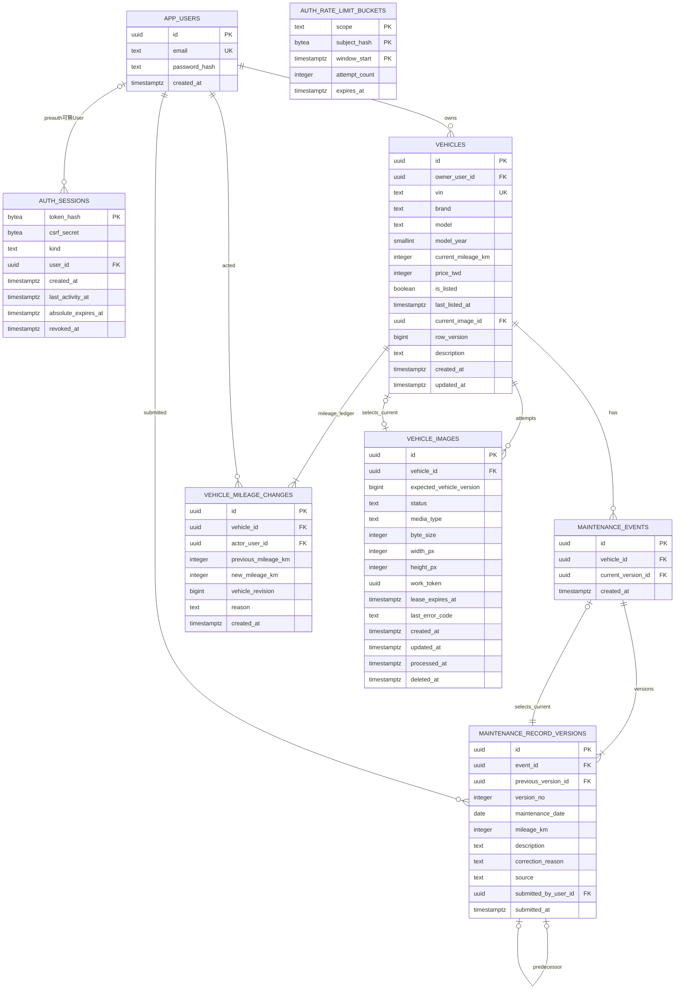

# Vibicle — Database Design & ERD

- 版本：v0.2，Step 2C.5 局部同步；日期：2026-11-04（Asia/Taipei）；Step 2B v0.1 保留於變更對照。
- 已完整閱讀的基線：[PRD v0.2](PRD.md)、[DECISIONS.md](DECISIONS.md)、[SYSTEM_ARCHITECTURE.md](SYSTEM_ARCHITECTURE.md)。
- 本輪僅將已接受CP-01～05／有條件CP-06同步四份上游Markdown；AUTH_DESIGN.md v0.1來源不改。沒有建立Database、執行SQL、產生Migration、安裝套件或修改應用程式。
- SQL全部是未執行的教學與設計範例；PostgreSQL版本、ORM及實際部署仍待確認。
- 保證標記：**[PG]** 是在正確建立Constraint／權限及正常DB設定下的原生保護；**[APP]** 依賴Python Service／可信寫入流程；**[TEST]** 尚須實際測試。不能把紙上設計當成驗收通過。

## 0. 設計摘要與不變量

建議以七張業務／登入核心表，另加一張已按CP-02定為Fixed Window的技術支援表；仍共八張設計表，尚未建立。選擇「Maintenance Event＋Maintenance Record Version」分表；Event保存唯一的目前版本指標，Version保存完整、追加式內容。不存一套容易與指標失配的 `is_current` Boolean。

- **C**：`vehicles.current_mileage_km`，目前自行申報里程。
- **E**：每個Maintenance Event的 `current_version_id` 指向的版本集合。
- **H**：E的最大里程；沒有事件時為0。不對全部舊版本取MAX。
- C≥H；不同日期的有效里程非遞減；同日不假設事件順序。
- 補登／更正不自動修改C；下修C需理由、確認、保留前後值。
- 更正指向同事件目前末端，追加完整替代版本；原文不UPDATE／DELETE。每個事件只一個有效末端。
- 全部影響同車不變量的Writer取得同一Vehicle Row Lock，再讀最新狀態／驗證／提交。並行安全不是只加BEGIN。
- 未上架僅Owner可讀，包含所有版本、里程下修摘要與照片；DB存Metadata，API授權後才讀私有檔案。

保留FR-013及全部現行BR。FR-006-AC03、FR-011-AC02／03／05是已停用歷史條款，不作本設計的驗收依據。

## 1. Entity Identification 與重要取捨

| Entity／Table | What／Why | How | Alternative／Failure |
| --- | --- | --- | --- |
| User／`app_users` | 平台帳號；與可有多台車的Owner分開。 | Email正規化唯一、Password Hash、UUID。 | 不用一張表重複每車的帳密；明文密碼或僅Frontend身分會失守。 |
| Session／`auth_sessions` | 可共享撤銷的登入／登入前上下文，不是Browser中的User聲明。 | Token Hash為PK，authenticated時連User；preauth時不代表登入。 | 本機dict重啟丟失且跨Worker不共享；Cookie簽章Payload不等於本Server Session。 |
| Vehicle／`vehicles` | 車輛聚合的一致性入口。 | Owner、唯一合成VIN、C、刊登狀態、目前圖片指標及row_version。 | 不拆成價格／刊登微服務；跨表規則仍須同車交易。 |
| Maintenance Event／`maintenance_events` | 一次實際申報的維修事件，身份不因更正改變。 | 連Vehicle並指向目前有效版本。 | 單表版本鏈亦可，但有效事件／車輛歸屬查詢較易混淆；詳見第6節。 |
| Record Version／`maintenance_record_versions` | 一個事件的一份完整內容版本。 | event_id、previous_version_id、version_no、事件日期／里程／描述與更正理由。 | 不用只存差異Patch或文字「上一筆有誤」；否則難計算有效里程。 |
| Mileage Change／`vehicle_mileage_changes` | C的初始及每次異動事實，不是維修事件。 | 前後值、申報者、理由、Server時間；與C更新同交易。 | 不拿可輪替Log代替持久歷史；遺漏同交易寫入會造成帳不一致。 |
| Image Metadata／`vehicle_images` | 圖片工作、處理後檔案與生命週期。 | 每個候選主圖有UUID、狀態、尺寸、Lease、預期Vehicle版本；有效主圖由Vehicle指標決定。 | bytes不放本表；也不存公開路徑作授權。DB與Filesystem失敗需協調。 |
| Rate-limit Bucket／`auth_rate_limit_buckets` | 支援既有NFR-SEC-05，不是新增業務功能。 | 來源摘要、Scope、時間窗與計數；無User FK，避免只有已知帳號才被限流。 | 本機Counter不能跨Worker可靠共享；固定窗與滑動窗不等價，本表為固定窗候選，語意須2C定案。 |

不另建：Marketplace、Garage（是Vehicle Query）；Digital Passport（是事件／版本關係）；Role／Organization／Order／Payment（非MVP）；Current Version（已由指標表示）；Image bytes（Private Volume）；一般Audit万能JSON表（以明確C異動與版本表承接）。照片上傳者本輪恆為不可移轉的Vehicle Owner，可由Vehicle推得，先不重複存；紀錄／里程的申報者則是PRD明確要求保留的歷史行為人。

## 2. ER Diagram

圖列重要欄位；完整欄位、NULL與Composite FK見第4／5節。Mermaid中的FK只標單欄角色，不能取代文字的複合鍵定義。

關係解讀：

- 一位User可擁有0～N台車；每車恰有一個Owner，MVP不移轉。
- Session可無User僅限preauth；authenticated Session必須恰有一User，不能把preauth當登入。
- 一台車可有0～N事件；每個已提交Event至少一版本，恰有一個current pointer；每個Version恰屬一Event，但歷史Version不一定被選為current。
- 一版可有0或1前版，且至多一個直接後繼。FK／Unique並不單獨證明整鏈都從根可達或current必為末端，仍有第6節[APP]協定。
- 一車可有多個圖片嘗試／舊圖，但0或1張目前主圖；圖片最多被它自己的車選為current。
- 每車建車交易建立一筆初始C ledger，再記錄後續異動；「至少一筆」由[APP]建車協定保證，不是單靠Child FK自動產生。
- Rate-limit Bucket沒有User關聯；Fixed Window已按CP-02定版，可信來源／Proxy與多Worker效果仍待實測。

## 3. PostgreSQL型別決策

| 比較 | 本提案／理由 | 取捨、Alternative與Failure |
| --- | --- | --- |
| UUID vs BIGINT PK | 主要業務Entity用UUID；預設候選`gen_random_uuid()`，需要先知道Version ID時由可信Service先產生UUIDv4。 | UUID16 bytes、BIGINT8 bytes，UUID較長且隨機插入有索引成本；BIGINT Identity對單DB更簡單也可。此規模不以效能選勝負；UUID不是權限防護。Session例外用32-byte Token Hash PK。 |
| INTEGER vs BIGINT | km上限2,000,000、TWD上限100,000,000、圖片≤5MiB、版本序號用INTEGER；年份用SMALLINT；聚合row_version與Ledger的vehicle_revision用BIGINT。 | INTEGER上限2,147,483,647已足夠；不把價格用float／money。BIGINT非自動較安全，仍需CHECK與溢位驗證。 |
| TIMESTAMPTZ vs TIMESTAMP | Server申報／更新／Session時間用TIMESTAMPTZ。DB連線建議UTC顯示，產品以Asia/Taipei呈現。 | TIMESTAMPTZ記時間點，不保留原始時區名稱；TIMESTAMP沒有時區解讀易混淆。不是單純把使用者時區字串存進欄位就完成。 |
| DATE vs TIMESTAMP | 維修事件日期用DATE，申報時間另用TIMESTAMPTZ。 | 不捏造同日事件的時間；不能用submitted_at排序來驗證同日里程先後。 |
| BOOLEAN vs狀態 | Vehicle只有已上架／未上架，用NOT NULL BOOLEAN。Image有多階段，用TEXT＋CHECK值集合；Session kind同理。 | 不創造sold／transferred新狀態。PG ENUM可更嚴謹但演進另有成本；TEXT不代表可任意存值。 |
| TEXT vs VARCHAR | 文字多用TEXT＋char_length／內容CHECK，直接對照PRD界線；不另保存同義品牌表。 | VARCHAR(n)也可，沒有本案足以證明的速度優勢；TEXT不是免驗證。Password Hash不套用原始密碼12–128的長度限制。 |
| Email唯一 | 只存canonical Email：Service trim／驗證器normalized→PostgreSQL lower；保存／Lookup用同DB語意，既有lower／btrim CHECK及UNIQUE不變（CP-04）。 | 不另用Python casefold；UTF-8、Collation／Locale、Library版本與Unicode Fixtures必須記錄／實測，不宣稱視覺相似字元等價；btrim不是Email驗證器。 |
| VIN唯一 | 合成VIN先trim＋upper，DB格式CHECK與UNIQUE；格式為17碼且排除I／O／Q。 | 不用前端「先查有沒有」代替唯一Constraint；唯一性不證明真實車籍。 |
| Default時間 | 本文件以`T`簡寫`statement_timestamp()`，為該SQL Statement開始時間；不是待建立的自訂函式。 | `CURRENT_TIMESTAMP/now()`是Transaction開始時間；長交易判Session不能誤用舊時間。等待Lock後需另取時間重新檢查。 |

以上工具語意參考 [Numeric Types](https://www.postgresql.org/docs/current/datatype-numeric.html)、[Date/Time Types](https://www.postgresql.org/docs/current/datatype-datetime.html)、[Time Functions](https://www.postgresql.org/docs/current/functions-datetime.html)、[UUID Functions](https://www.postgresql.org/docs/current/functions-uuid.html)。版本選定後仍須核對，未建立Extension或套件。

## 4. Data Dictionary／Schema Proposal

記號：NN=NOT NULL；NULL=可空；G=`gen_random_uuid()`；T=`statement_timestamp()`；「無」表示必須由可信Service提供、不是客戶端可任意指定。UUID PK不可修改。未指定的FK均ON DELETE RESTRICT／ON UPDATE RESTRICT；沒有業務資料刪除或Cascade刪歷史功能。Optional欄位預設NULL。

### 4.1 app_users

| Column | PostgreSQL Type | Null | Default | Key／理由 |
| --- | --- | --- | --- | --- |
| id | UUID | NN | G | PK；帳號識別，不是Session Token。 |
| email | TEXT | NN | 無 | UQ；canonical登入識別，最多254字元。 |
| password_hash | TEXT | NN | 無 | 專用Password Hash編碼，絕不保存原密碼。 |
| created_at | TIMESTAMPTZ | NN | T | Server建立時間。 |

**[PG] Constraints**：PK(id)、UNIQUE(email)；Email為lower(email)及btrim(email)形態、char_length在1～254；Hash非空。**[APP]** 註冊／登入共同trim→驗證器normalized（不做deliverability／DNS驗證）→PG lower，最終1～254 Code Points；不做provider dots／plus合併。Password仍12～128字元、不trim／截斷、Argon2id Library Hash，註冊後手動登入。CP-04方向已接受；必記PG UTF-8 Encoding、欄位／Lookup使用的Collation／Locale及版本、Python／驗證器／Hash Library版本，驗大小寫、Unicode正規化與F(F(email))=F(email)、併發Unique及升版碰撞。不能宣稱全部Unicode／視覺相似問題已解決，亦不另用Python casefold作唯一性Key。**Index**：PK與Email Unique自動產生的B-tree已足夠。

**CP-04環境／Fixtures紀錄（實際值待選定環境填入，禁止拿本機OS設定冒充PG配置）**：

| 紀錄項目 | 本輪狀態／必留證據 |
| --- | --- |
| PostgreSQL版本／server_encoding | 設計要求UTF8；實際Server版本與Encoding未量測。 |
| DB與email欄位Collation／Locale | provider、collation名稱／deterministic屬性／版本、LC_COLLATE／LC_CTYPE等依所選PG版本記錄，實際值未定；Lookup／CHECK／Unique需同語意。 |
| Python／驗證Library | Python、email-validator實際版本與正規化設定未鎖定；保存版本／設定及升版對照。 |
| Hash Library／成本 | Argon2id已選；pwdlib／後端版本及成本／同時工作數實際值未量測，不把AUTH候選參數當測量結果。 |
| Unicode／Unique Fixtures | 英文大小寫／前後Unicode空白、NFC合成／分解、國際化Domain及local-part、特殊大小寫／同形但不保證等價案例、F(F(x))=F(x)、註冊／登入一致、兩連線Unique及升版碰撞；全未執行。 |

### 4.2 auth_sessions

| Column | Type | Null | Default | Key／理由 |
| --- | --- | --- | --- | --- |
| token_hash | BYTEA | NN | 無 | PK；32-byte SHA-256摘要，不是可拿來直接登入的原Token。 |
| csrf_secret | BYTEA | NN | 無 | CP-01；每preauth／authenticated Context各自CSPRNG生成32 bytes，終身固定、無共用Default、無Unique／Index；不是Session ID。 |
| kind | TEXT | NN | 'authenticated' | CHECK只允許authenticated／preauth。 |
| user_id | UUID | NULL | NULL | FK→app_users.id；preauth無User，authenticated必須有。 |
| created_at | TIMESTAMPTZ | NN | T | 本次上下文建立時間，不能隨活動重設。 |
| last_activity_at | TIMESTAMPTZ | NN | T | authenticated最後合格成功業務活動；建立時等於created_at；preauth永遠等於created_at、不續期。 |
| absolute_expires_at | TIMESTAMPTZ | NN | 無 | authenticated建立時為created_at＋8小時；preauth固定created_at＋15分鐘。 |
| revoked_at | TIMESTAMPTZ | NULL | NULL | 本次撤銷時間；不可被普通touch清回NULL。 |

**[PG] Constraints（設計，未建立）**：PK(token_hash)、User FK不變；octet_length(token_hash)=32、octet_length(csrf_secret)=32及NN；kind只允許authenticated／preauth，且authenticated user_id非NULL、preauth user_id=NULL。共同created_at≤last_activity_at<absolute_expires_at；authenticated absolute=created＋INTERVAL '8 hours'；preauth absolute=created＋INTERVAL '15 minutes'且last_activity=created；revoked若非NULL不得早於created。CP-01／03不新增Unique／FK／Index，I-06仍按absolute清理。

**[APP]** 兩個Secret獨立安全亂數生成，Native CHECK只能驗bytes／列形態，不能證明熵或跨Context獨立性。Login建立全新authenticated列並同交易撤銷舊Context，不就地更新kind／User／期限升級；每次建立以同一可信t明填created／last／absolute，避免兩個不同Statement時間失配。preauth只供安全流程，不是有30分鐘閒置的User Session。

**[PG權限提案＋APP]** Runtime若只有Session的SELECT／INSERT與UPDATE(last_activity_at,revoked_at)，且沒有table-wide UPDATE或較廣角色權限，可阻止一般Request改kind、user_id、created／absolute、Token Hash及csrf_secret；清理／Migration使用分離的受控權限。此為CP-03／05的最小防錯權限設計，尚未GRANT；依[PostgreSQL Privileges](https://www.postgresql.org/docs/current/ddl-priv.html)，需確認角色不是Table Owner／Superuser且不繼承較廣權限。CHECK本身仍允許某些就地提升／改期限的合法列，故不能冒稱單靠它已保護State Transition或撤銷單向；Touch／Logout依§8協定。

csrf_secret原bytes只在Store；指定CSRF介面可base64url返回Token，普通Session查詢／Response不可SELECT *序列化整列。Cookie的raw Session Token仍不入DB。已接受Synchronizer方案，不再把有無此欄位留到2C；AUTH_DESIGN §12中的「尚未回填」是審查前快照，現行整合狀態見DECISIONS §6。

### 4.3 vehicles

| Column | Type | Null | Default | Key／理由 |
| --- | --- | --- | --- | --- |
| id | UUID | NN | G | PK；同車Row Lock的錨點。 |
| owner_user_id | UUID | NN | 無 | FK→app_users.id；從有效Session決定。 |
| vin | TEXT | NN | 無 | UQ；canonical合成VIN。 |
| brand | TEXT | NN | 無 | trim後1～50字元。 |
| model | TEXT | NN | 無 | trim後1～100字元。 |
| model_year | SMALLINT | NN | 無 | DB靜態範圍1900～9999；動態當年＋1由Service驗證。 |
| current_mileage_km | INTEGER | NN | 無 | C，0～2,000,000；不是H快取。 |
| description | TEXT | NN | '' | 選填純文字，最多2000字元。 |
| price_twd | INTEGER | NULL | NULL | 1～100,000,000；未上架可空。 |
| is_listed | BOOLEAN | NN | false | 僅兩個產品狀態。 |
| last_listed_at | TIMESTAMPTZ | NULL | NULL | 最近真正未上架→上架時間；下架保留。 |
| current_image_id | UUID | NULL | NULL | Composite FK F-04；0或1張目前主圖。 |
| row_version | BIGINT | NN | 1 | >0，聚合成功異動後遞增，防舊表單覆寫。 |
| created_at | TIMESTAMPTZ | NN | T | Server建立時間。 |
| updated_at | TIMESTAMPTZ | NN | T | Service在聚合異動時明確更新，PG不會因命名updated_at自動維護。 |

**[PG] Constraints**：UNIQUE(vin)；VIN正則 `^[A-HJ-NPR-Z0-9]{17}$`；brand／model已btrim且長度合規；各靜態數值／描述長度／row_version>0；`NOT is_listed OR (price_twd IS NOT NULL AND current_image_id IS NOT NULL AND last_listed_at IS NOT NULL)`；updated_at≥created_at。**[APP]** VIN／Owner不可一般修改、年式≤Taipei當年＋1、C≥H、圖檔ready／存在、上架時間只在真正狀態轉移更新、row_version與updated_at更新。**Index**：見I-01／02及VIN UQ，不對每個欄位加Index。

型別INTEGER只保證保存結果為整數；輸入如小數若先被程式／SQL強制轉型，可能已經改值。Service必須在轉型前拒絕不合規價格／里程，而非四捨五入或截斷。

### 4.4 maintenance_events

| Column | Type | Null | Default | Key／理由 |
| --- | --- | --- | --- | --- |
| id | UUID | NN | G | PK；同一維修事件的不變識別。 |
| vehicle_id | UUID | NN | 無 | FK→vehicles.id；事件歸屬只存這裡。 |
| current_version_id | UUID | NN | 無 | Composite FK F-02；必有一份目前內容。 |
| created_at | TIMESTAMPTZ | NN | T | 初次申報時間，不是維修日期。 |

**[PG]** PK、Vehicle FK、F-02防跨Event指標；沒有事件內容、source或 `is_current` 的另一份複製。**[APP]** Event的vehicle_id建立後不可搬到別車；current必須指向末端、不可倒退回舊版。**Index**：I-03(vehicle_id)；PK足以鎖定／找單一Event，實際共同鎖仍在Vehicle。

### 4.5 maintenance_record_versions

| Column | Type | Null | Default | Key／理由 |
| --- | --- | --- | --- | --- |
| id | UUID | NN | G | PK；每份完整原文／更正內容的ID。 |
| event_id | UUID | NN | 無 | FK→maintenance_events.id。 |
| previous_version_id | UUID | NULL | NULL | F-03，同Event前版；初版NULL。 |
| version_no | INTEGER | NN | 無 | 初版1；更正版前版＋1，版本順序不是事件時間。 |
| maintenance_date | DATE | NN | 無 | 實際自行申報的維修日，可早於建車日。 |
| mileage_km | INTEGER | NN | 無 | 該次維修里程，0～2,000,000。 |
| description | TEXT | NN | 無 | trim後1～2000字元的完整內容。 |
| correction_reason | TEXT | NULL | NULL | 初版無；更正版必填1～500字元。 |
| source | TEXT | NN | 'owner_self_reported' | CHECK固定此值，UI顯示車主自行申報／未經機構驗證。 |
| submitted_by_user_id | UUID | NN | 無 | FK→app_users.id，保存當時申報者的事實。 |
| submitted_at | TIMESTAMPTZ | NN | T | Server申報時間；不得充當維修時間。 |

**[PG] Keys**：PK(id)、UNIQUE(event_id,id)供複合FK、UNIQUE(event_id,version_no)、UNIQUE(previous_version_id)。最後一個Unique採預設NULL彼此不同：不同Event可各有一個NULL前版，不用NULLS NOT DISTINCT。

**[PG] Checks**：version_no≥1；previous_version_id若有值不得=id；初版必須version_no=1、previous=NULL、reason=NULL；更正版必須version_no>1、previous非空、reason非空且trim長度1～500。mileage範圍、description長度、source常數、maintenance_date≥DATE '1900-01-01'。**[APP]** 日期≤Taipei今日、parent恰為目前末端且version_no=parent＋1、Owner、跨日里程及C界線。Index由三個Unique與PK提供；UNIQUE(event_id,version_no)也支援整鏈順序查詢，不再另建同樣Index。

Version與Mileage Change上的author／actor保存「當時行為人」，不是從目前Owner動態猜測的顯示欄；沒有因此新增移轉功能。Server預設時間本身不阻止有DB權限者指定其他時間，故API不得綁定客戶端傳來的author／submitted_at。

### 4.6 vehicle_mileage_changes

| Column | Type | Null | Default | Key／理由 |
| --- | --- | --- | --- | --- |
| id | UUID | NN | G | PK；持久里程異動識別。 |
| vehicle_id | UUID | NN | 無 | FK→vehicles.id。 |
| actor_user_id | UUID | NN | 無 | FK→app_users.id，可信身分。 |
| previous_mileage_km | INTEGER | NULL | NULL | 僅建車初始列為NULL。 |
| new_mileage_km | INTEGER | NN | 無 | 初始C或變更後C。 |
| vehicle_revision | BIGINT | NN | 無 | >0；保存這次C提交後Vehicle.row_version，與vehicle_id組合Unique；歷史快照不是FK。 |
| reason | TEXT | NULL | NULL | 下修必填1～500字元；提高可選填。 |
| created_at | TIMESTAMPTZ | NN | T | Server記錄時間。 |

**[PG]** UNIQUE(vehicle_id,vehicle_revision)、vehicle_revision>0；兩個非空里程值皆在範圍；若previous非空則new≠previous；降低時reason必非空且trim長度1～500，若其他情況有reason也需合規；Partial UNIQUE(vehicle_id) WHERE previous_mileage_km IS NULL防止重複初始列。**[APP]** 建車一定建立初始列、previous等於鎖定後原C、new等於新C且同交易更新，vehicle_revision等於該次提交後的row_version（初始為1）；不能只加Ledger而不更新C，或反過來。無變動不加Ledger。**Index**：I-04就是上述Composite Unique所建的Index，供某車修訂順序；actor不先獨立加Index。不以可能同值的created_at或隨機UUID推斷先後。

### 4.7 vehicle_images

| Column | Type | Null | Default | Key／理由 |
| --- | --- | --- | --- | --- |
| id | UUID | NN | G | PK，同時為檔案識別；處理後key由可信Storage Adapter導出images/{id}，不接受客戶端路徑。 |
| vehicle_id | UUID | NN | 無 | FK→vehicles.id；UQ(vehicle_id,id)支援F-04。 |
| expected_vehicle_version | BIGINT | NN | 無 | 上傳意圖基於的Vehicle row_version快照，>0；不是FK。 |
| status | TEXT | NN | 'pending' | pending／processing／ready／failed／deleting／deleted。 |
| media_type | TEXT | NULL | NULL | 處理後image/jpeg、image/png或image/webp。 |
| byte_size | INTEGER | NULL | NULL | 處理後檔案1～5,242,880 bytes。 |
| width_px | INTEGER | NULL | NULL | 處理後寬1～6000。 |
| height_px | INTEGER | NULL | NULL | 處理後高1～6000，寬×高≤12,000,000。 |
| work_token | UUID | NULL | NULL | 處理／清理claim識別；擋住過期工作回來提交。 |
| lease_expires_at | TIMESTAMPTZ | NULL | NULL | claim到期時間；清理前還須查目前主圖與狀態。 |
| last_error_code | TEXT | NULL | NULL | 非秘密的失敗分類，不存Stack Trace、原檔或個資。 |
| created_at | TIMESTAMPTZ | NN | T | 上傳意圖時間。 |
| updated_at | TIMESTAMPTZ | NN | T | 目前工作／狀態變動時間。 |
| processed_at | TIMESTAMPTZ | NULL | NULL | 處理完成時間，ready必有值。 |
| deleted_at | TIMESTAMPTZ | NULL | NULL | 實際確認檔案刪除後才填，Metadata仍可保留。 |

**[PG]** status／media_type白名單、個別非NULL尺寸／bytes及總像素上限；ready必有全部最終Metadata與processed_at。pending／processing／deleting必有work_token與lease_expires_at（>created_at）；是否已在此刻過期仍由[APP]判定，CHECK不自動隨時間撤銷工作。ready／failed／deleted時二者NULL。failed必有非空error_code；deleted必有deleted_at，其餘deleted_at=NULL；updated_at≥created_at，已填processed_at／deleted_at不早於created_at。ready不等於current，替換後舊ready可等待清理。

**[APP]** Image的vehicle_id建立後不可改；只允許合法狀態轉移、當前Claim持有者且Lease仍有效才完成工作；ready證據來自實際受限處理／bytes保存，DB不能驗證Filesystem或EXIF。**Index**：PK、UNIQUE(vehicle_id,id)、I-05(status,updated_at)。檔案key直接由UUID導出，故不重複保存可失配的檔案路徑、公開URL或 `is_current`。

### 4.8 auth_rate_limit_buckets（CP-02已接受的Fixed Window模型）

| Column | Type | Null | Default | Key／理由 |
| --- | --- | --- | --- | --- |
| scope | TEXT | NN | 無 | 複合PK一部分，CHECK login／register／csrf_context。 |
| subject_hash | BYTEA | NN | 無 | PK一部分，32-byte來源HMAC摘要；不是低熵IP直接SHA-256，也不是User FK。 |
| window_start | TIMESTAMPTZ | NN | 無 | PK一部分，可信Server計算的固定窗起點。 |
| attempt_count | INTEGER | NN | 1 | >0，以原子衝突更新計數，不能應用程式先讀再寫。 |
| expires_at | TIMESTAMPTZ | NN | 無 | >window_start，供清理；實際限制在接收請求時判定。 |

**[PG]** Composite PK(scope,subject_hash,window_start)、Hash長度32與欄位CHECK。**[APP]** 可信Proxy後的canonical IP／跨Worker共用HMAC Secret、PG可信Clock、UTC Epoch固定窗及上限；expires_at=window_end，counter可飽和N＋1。**Index**：PK做Bucket Lookup、expires_at供清理。不存raw IP、帳號是否存在或密碼。

CP-02已定：login N=20／300秒、register N=10／3600秒、csrf_context N=60／300秒，UTC Epoch對齊的Fixed Window；到達Gate的成功／失敗嘗試都計數（來源先拒絕者除外），第N＋1次429與Retry-After。Gate獨立短交易Commit，後續CSRF／憑證／業務拒絕不退額度。窗交界Burst、NAT共用IP與分散來源風險保留，不等同精確Sliding Window；數值／時間窗／可信來源不是Composite PK自動決定。原子UPSERT見Q-10，實作前需多Worker測試。

## 5. Constraints & Index Strategy

### 5.1 必須寫進Migration的關聯，而非僅畫ERD

| ID | Constraint提案 | [PG]實際保護／不能多宣稱的部分 |
| --- | --- | --- |
| F-01 | versions.event_id→events.id，即時FK | 不能引用不存在的Event；因此初建先插Event，再插初版。 |
| F-02 | events.(id,current_version_id)→versions.(event_id,id)，DEFERRABLE INITIALLY DEFERRED | Commit時current恰屬同Event且存在；避免錯指另一Event。Event current NOT NULL，因此不能提交沒有任何版本的Event。不能證明它必是末端。 |
| F-03 | versions.(event_id,previous_version_id)→versions.(event_id,id)，NOT DEFERRABLE，預設MATCH SIMPLE | 前版存在且屬同Event；初版previous=NULL可略過FK。不是跨車任意連線。 |
| F-04 | vehicles.(id,current_image_id)→images.(vehicle_id,id)，即時FK，MATCH SIMPLE | current_image只能屬該車，NULL表示無圖。不能證明status=ready或檔案真的存在。 |
| U-01 | User Email、Vehicle VIN Unique | 任意合法連線併發插入不能產生兩個相同canonical值；正規化仍需共同流程。 |
| U-02 | UNIQUE(versions.previous_version_id) | 同一前版最多一個直接後繼，無分叉；NULL可重複。 |
| U-03 | UNIQUE(versions.event_id,version_no)＋初版CHECK | 同Event不重複序號，最多一個version_no=1初版。不能單獨保證所有序號連續／整鏈可達。 |
| U-04 | 初始Mileage Change Partial Unique | 每車最多一個初始列；至少一個仍由Service建車交易保證。 |
| U-05 | UNIQUE(vehicle_mileage_changes.vehicle_id,vehicle_revision) | 每車同修訂至多一筆C異動；revision與當次Vehicle提交後版本相符仍由[APP]保證。 |

F-02解決插入循環：可信Service先產生初版ID；同Transaction插Event（current指該ID）、再插初版（event_id指已存在Event），Commit才檢查F-02。若初版插入失敗就Rollback，不能先Commit半套Event。具體DDL依賴順序與ORM映射留Migration設計，不以把current改成永久可空來規避。

**CHECK不是萬能規則引擎**：

- [PG] CHECK遇NULL可以通過，所以「價格必填」「更正理由必填」必須明寫IS NOT NULL並搭配NN。
- [APP] C≥H、跨日里程、目前版本必為末端、parent序號＋1、status轉移、Owner驗證，不能用跨表SELECT塞進普通CHECK假裝維持。
- [APP] 「維修日期≤今日」「年份≤當年＋1」在操作時以Taipei日期檢查，不在CHECK依賴會改變的CURRENT_DATE；DB只保護不隨時間變化的下界／型別範圍。
- [PG＋設定] Runtime角色對Version／Mileage Ledger只授予SELECT／INSERT，不授UPDATE／DELETE；User／Vehicle不可變欄位也限制一般更新路徑。Session欄位更新權限及preauth／authenticated列內CHECK依§4.2（CP-01／03／05）；Migration／清理角色另管。這可限制正常Runtime誤改原文，不保證DB管理者也不能修改。
- 不新增Trigger／Stored Procedure複製全部Python規則作MVP前置條件。若未來允許不經Service的多個Writer，必須重審並集中到DB程序／Trigger等，不可繼續聲稱目前[APP]協定自動有效。

依據：[PostgreSQL Constraints](https://www.postgresql.org/docs/current/ddl-constraints.html) 對NULL、FK、Check不可依賴其他列及FK不自動產生引用端Index的說明。

### 5.2 只為真實查詢加Index

PK／Unique建立所需B-tree，勿再建同欄位重複Index。下列列出查詢使用的Index；除I-04是已述Unique自帶Index，其餘為額外候選：

| ID | Index／Predicate | 真正用途與代價 |
| --- | --- | --- |
| I-01 | vehicles(owner_user_id,created_at DESC,id DESC) | 車庫依Owner查詢與穩定順序；建立／更新需維護。 |
| I-02 | vehicles(last_listed_at DESC,id DESC) WHERE is_listed | 公開列表排序／12筆分頁；刊登狀態變動須維護，不保證包含搜尋也能靠此加速。 |
| I-03 | maintenance_events(vehicle_id) | 找某車事件、有效版本Join與H計算；維修日期不重複搬到Event。 |
| I-04 | UNIQUE vehicle_mileage_changes(vehicle_id,vehicle_revision) | 依車查看C異動與下修摘要的可靠提交順序；Unique自帶，不重建另一Index。 |
| I-05 | vehicle_images(status,updated_at) | 清理候選／卡住的工作；命中後仍要查Lease、Current與Claim，不能靠Index決定安全刪除。 |
| I-06 | auth_sessions(absolute_expires_at) | 分批清理；閒置過期的Row可延至絕對到期才回收，仍不影響認證拒絕。 |
| I-07 | auth_rate_limit_buckets(expires_at) | 回收過期計數，不代表清理前請求免限流。 |

UNIQUE(event_id,version_no)已支援整鏈排序；UNIQUE(event_id,id)與UNIQUE(vehicle_id,id)是複合FK目標所需額外唯一鍵，即使id單欄已唯一也不能省略FK需要的對應鍵定義。

品牌／型號任意位置包含查詢先依公開範圍篩選，不假稱一般B-tree能解決所有子字串搜尋。初期合成資料量小，先量測EXPLAIN／實際查詢；必要時才比較pg_trgm等索引方案，不能無證據先安裝Extension。Partial Index的Predicate需與Query相容，也不能用now()作持續自動更新的條件。參考 [Partial Indexes](https://www.postgresql.org/docs/current/indexes-partial.html)。

## 6. Normalization Analysis & Maintenance Versioning Decision

### 6.1 Normalization不是把每個欄位拆成一張表

| 概念 | 定義 | 本設計的檢查 |
| --- | --- | --- |
| 1NF | 每列可識別、每欄為所選資料模型的一個值，沒有重複欄組。 | 每個Version一列，不用maintenance_1／maintenance_2，也不把事件列表藏在Vehicle JSON Array。JSON本身不是一律不合法；但本案需要FK、查詢、逐事件更正與併發，關聯模型更直接。 |
| 2NF | 已符合1NF，非鍵屬性不只依賴候選複合鍵的一部分。 | 主要表以單欄PK識別事實；Rate-limit計數屬於scope＋subject＋window整個Bucket。User Email不重複塞在每台車。 |
| 3NF | 已符合2NF，非鍵屬性不透過另一個非鍵事實取得不必要的傳遞依賴。 | Vehicle存owner_user_id，不存Owner Email／Password；Version存event_id，不再重複vehicle_id；圖片路徑由ID導出，不另存一份易失配字串。 |

User與Vehicle分表使一位Owner有多台車時只更新一次Email，也避免刪車誤刪帳號。品牌與型號先作有長度限制的字串；沒有完整車系目錄的業務需求，不為形式上的「正規化」創造Manufacturer／Model管理功能。

**C與歷史里程不是同一份資料的冗餘**：C是目前申報值，維修里程是某個歷史日期的事件讀數。補登50,000 km不能把目前80,000 km覆蓋成50,000；更正歷史也不替Owner重新申報C。

下列重複／衍生資訊是有目的的，必須說清維護責任；因此不宣稱所有欄位都是嚴格無冗餘的3NF：

- **current_version_id、current_image_id**：選擇哪一版有效的關聯，不另存is_current。指標與Version插入／照片ready切換同Transaction；FK只保護存在及歸屬。
- **version_no**：順序可由鏈推得，為查詢／顯示清楚而存；Service要求parent＋1，Unique防同事件重號，不假稱DB已證明連號。
- **vehicles.current_mileage_km與Ledger最後new值**：前者是當前狀態、後者是不可覆寫的異動事實。建車／每次C實際改變都同交易寫兩者；No-op不新增Ledger。[TEST]以整合測試檢查最後值與連續前後值。Ledger保存提交後vehicle_revision，Unique防同車重號；可按它排序，避免同時間戳／隨機UUID造成歧義。它不是FK，因Vehicle當前版本會繼續增加。
- **row_version**：樂觀鎖用的聚合修訂號，不是維修版本數；每次聚合狀態／履歷變動一起遞增，不能由Frontend自訂。
- **submitted_by_user_id／actor_user_id**：MVP只有固定Owner可寫，與Owner有可推得的重複；依PRD保留當時行為人的Audit Snapshot。[APP]寫入時必等於可信Owner，單一User FK不保證這件事。
- **source**：目前固定owner_self_reported，留在Version明示原始申報來源，CHECK防偽造機構驗證。不是新增Organization或認證功能。
- 不存H、歷史日期邊界、公開VIN末六碼、圖片公開URL等可即時導出的值。

### 6.2 方案比較與選擇

| 面向 | A：Event＋Record Version分表（建議） | B：單表Self-referencing Chain |
| --- | --- | --- |
| What | Event有固定身份／車輛／current；Version有完整內容與parent。 | 所有版本在一表，previous_id指前版；可用root_id辨識事件，用「無後繼」求末端。 |
| 一致性 | 同Event Composite FK、Unique parent、明確current pointer；仍需Service維持末端／日期規則。 | 少一表，但要確保root／vehicle_id不被錯配；若也存root pointer／is_current，就要另外維護一致性。 |
| Schema複雜度 | 一個循環FK需Deferred檢查，初建多一筆Event。 | 最簡版本少一表；嚴謹維持根、同車及唯一有效末端後，約束並不自動更簡單。 |
| 查詢成本 | Event JOIN current Version直接取E；全鏈用event_id排序。 | 以NOT EXISTS後繼求末端，或從根Recursive CTE；也能正確實作，但容易把全部版本當有效。 |
| Concurrency | 同Vehicle Lock＋expected current ID；Event指標提供明確比較點。 | 同樣需要Vehicle Lock及Unique previous，不能靠表數較少免鎖。 |
| 原文保留 | Version只INSERT，Event只換指標。 | 同樣可只INSERT；若用每版is_current則另需UPDATE舊列並保護只一個true。 |
| 維護成本 | Event對應使用者理解的一次維修，適合FR-013與歷史UI。 | 基礎Append很短，但更正／整鏈／歸屬規則較容易散在Query。 |
| Failure | 指標被錯誤Writer改到舊版仍可能通過FK；需共同Service與權限。 | root／parent／末端誤判、分支、漏排舊版也可能發生；不是天然較弱，只是維護協定不同。 |

**採A**。多一張Event表及Deferred FK有明確教學成本，但讓「事件」與「內容版本」區分清楚。未加Recursive Tree、一般Event Sourcing框架或資料庫Trigger引擎。此為設計提案，並非已建立Schema。

### 6.3 十個必要行為如何實作

| # | 行為 | 協定與保證邊界 |
| --- | --- | --- |
| 1 | 某事件有效版本 | events.current_version_id JOIN versions.id，且event_id相符；F-02保護歸屬，[APP]只指向目前末端。 |
| 2 | 全部有效事件E | 找該車所有Event，各Join其current；不以「最新submitted_at」猜有效，也不把更正當新Event。 |
| 3 | 計算H | MAX(E.mileage_km)，空集合0。被取代版本即使有很高里程也不參與。 |
| 4 | 補登歷史 | 同車Lock後，以新日期／里程對最新E驗證；新Event＋初版同交易。事件日期可早於建車日，不早於1900、不晚於Taipei今日。 |
| 5 | 更正錯誤里程 | Owner指定event及expected current ID，填完整替代日期／里程／描述＋理由；以E移除該事件現版、放入新候選後整體驗證。通過才追加版並換指標；C不變。 |
| 6 | 原文／整鏈 | 每版完整Snapshot、parent ID、序號、來源、申報者／時間／更正理由。Runtime不UPDATE／DELETE Version；全鏈可讀，UI標示何版已取代與目前版。 |
| 7 | 不分叉 | U-02對parent唯一，[APP]需parent=鎖後讀到的current，且新UUID／序號parent＋1；失敗不偷偷改成更正別版。 |
| 8 | 不同日期一致 | 候選m需≥所有嚴格較早日期的最大值L，且≤所有嚴格較晚日期的最小值U，並≤C。這等價於新候選與其餘有效事件的所有跨日配對皆不倒退。 |
| 9 | 同日不同里程 | 同日彼此不比較大小；但每筆都要對前後「其他日期」檢查L／U。不是同日就完全免驗證，也不用submitted_at創造先後。 |
| 10 | 多筆錯誤互擋 | 不批次跳過衝突。回報候選與有效鄰接日期範圍、衝突Event／Version及規則；Owner依可行順序逐筆更正。完全無可行順序或舊資料已違規時清楚回報，列受控資料修復議題，不私自刪除／忽略紀錄。 |

計算L／U時，更正必須排除「被更正事件的整個目前版本」，而非把舊版留在集合再驗證。候選的0～2,000,000整數、日期與文字界線也一起檢查。

驗證只需查同車最新E；若基線本身已滿足跨日規則，上述界線檢查即可維持不變量。[TEST]仍需檢查整個E的測試案例與異常資料診斷；若發現既有資料已違規，不能以局部驗證假稱已修好整車。

### 6.4 接受／拒絕的具體範例

以下日期均為示例，假設申報當日已晚於2026-03-10；km皆整數。

| 情境 | 目前有效資料與操作 | 結果／原因 |
| --- | --- | --- |
| 合理補登 | C=80,000；01-10=50,000、03-10=70,000；補02-10=60,000。 | 接受，L=50,000≤60,000≤U=70,000≤C；C仍80,000。 |
| 比較早日還低 | 同上，補02-10=49,000。 | 拒絕，低於01-10有效50,000，不是因為低於C。 |
| 比較晚日還高 | 同上，補02-10=71,000。 | 拒絕，高於03-10有效70,000。 |
| 同日沒有順序 | C=80,000；01-10=50,000、03-10=70,000；02-10分別60,000與65,000。 | 兩筆可接受；同日不比較申報先後。 |
| 同日仍有外部界線 | 上例另補02-10=75,000。 | 拒絕，雖與其他02-10同日，仍超過03-10的70,000。 |
| 高里程更正後可下修C | C=900,000；01-10=50,000、03-10誤填900,000。將後者V1更正V2=70,000附理由。 | 接受，V1仍存但不計H；H成70,000。再另行下修C=80,000需理由／確認與Ledger，接受。 |
| 下修順序錯誤 | 在上述V1仍有效時直接把C改80,000。 | 拒絕，H仍900,000。不能用「有打算更正」先忽略有效V1。 |
| 更正衝突 | C=100,000；01-10=90,000、02-10=95,000兩筆均誤填，想分別改50,000／60,000。 | 先改02-10=60,000會低於早日90,000而拒絕；先更正01-10=50,000，再改02-10=60,000可接受。每筆各自原子提交。 |
| 更正過時末端 | V1已被V2取代，另一分頁仍送「更正V1」。 | 拒絕並要求重讀V2；不自動將原輸入套到V2，無V3／分叉副作用。 |
| 同日最大值仍計H | C=80,000，同一天60,000與78,000；想把C改75,000。 | 拒絕，沒有同日順序不代表忽略78,000；H=78,000。 |
| 超過C／未來日期 | C=80,000，候選81,000；或日期晚於Taipei今日。 | 拒絕；Owner若要提高C須先獨立編輯，不由履歷自動提高。 |
| 改事件日期 | 把03-10=70,000更正到01-05，其餘有01-10=50,000。 | 拒絕，候選早日70,000反而大於晚日50,000；日期更正同樣要重算E。 |

## 7. Transaction & Concurrency Design

### 7.1 ACID在本案保證到哪裡

| 特性 | What／Vibicle用途 | Failure／限制 |
| --- | --- | --- |
| Atomicity | 建車＋初始Ledger、更正Version＋current指標、C更新＋Ledger，各自全成或全敗。 | BEGIN開交易，COMMIT才生效，ROLLBACK取消；不能把寫入拆成兩次獨立Commit。檔案不是同一資源。 |
| Consistency | Constraint使交易結果符合型別、Unique／FK／CHECK；Service維持C≥H等規則。 | DB不知道你沒寫進Constraint／協定的業務規則；單靠Transaction不會自動理解里程。 |
| Isolation | MVCC讓讀取看一致Snapshot；Row Lock序列化同車Writer。 | READ COMMITTED仍有Non-repeatable Read／跨列競態；不是「所有操作自動序列化」。 |
| Durability | 正常持久化設定下，已Commit的DB變更應可在重啟後保留。 | 仍需可靠Disk、WAL、Backup；不能關掉耐久設定後還宣稱相同保證，亦不保證照片Volume同步。 |

**READ COMMITTED候選**：每個Statement使用其開始時可見的已提交資料。同Transaction兩次SELECT可能看見不同Commit。等待FOR UPDATE鎖後，取得的是可更新的最新Row，但「其他表的查詢Snapshot」不會因此神奇全部更新；應在拿到Vehicle Lock後，**用下一個Statement**重讀Event／Version／Image並驗證，避免同一大CTE先讀舊E再等鎖。

原生依據：[Transaction Isolation](https://www.postgresql.org/docs/current/transaction-iso.html)、[Explicit Locking](https://www.postgresql.org/docs/current/explicit-locking.html)。

### 7.2 所有Writer遵守的共同協定 [APP]

1. 用有效Session取得可信User ID；CSRF／Request驗證後進入短交易。Owner ID不從可任意修改的表單採信。
2. 已有Vehicle的寫入，先以ID與Owner條件取得Vehicle Row Lock。車不存在或不是Owner時拒絕，不藉錯誤回應洩漏私人資料。
3. 拿鎖後比較必要的expected版本，再用新Statement讀最新E／C／Image。檢查欄位、C≥H、跨日規則、上架完整性等本次相關不變量。
4. 一般編輯／上架／下架／照片最終切換要求expected vehicle row_version；更正要求expected current Version ID。新增獨立Event可以不要求整車版本完全相等，但一定重讀最新資料驗證。
5. 寫入全部相關列並遞增Vehicle.row_version、更新updated_at。履歷異動也要遞增，使舊表單不能覆蓋剛變動的車輛聚合。
6. Commit後才回成功；任何失敗Rollback。若Commit結果因斷線不確定，不假稱一定Rollback，也不直接重送可能重複的新增操作，先查確認／回報不確定結果。

**Row Lock vs Optimistic Locking**：鎖用於互斥驗證；row_version用於發現使用者拿的是舊畫面。A、B即使依序拿鎖，如果B無條件以舊表單覆寫仍會Lost Update，因此兩者各有作用。Version只是序號，不承載權限。

教學骨架（不是完整可執行交易或Endpoint；全部使用參數）：

~~~sql
BEGIN;
SELECT id, current_mileage_km, row_version, is_listed, current_image_id
FROM vehicles
WHERE id = $1::uuid AND owner_user_id = $2::uuid
FOR UPDATE;
-- Service：拿鎖後檢查expected row_version。
-- 下一個Statement讀最新有效履歷；驗證通過才UPDATE／INSERT。
-- 同Transaction遞增row_version、更新updated_at及必要Ledger。
COMMIT;
-- 中途任何驗證／DB錯誤：ROLLBACK；不能繼續使用已失敗Transaction。
~~~

這裡刻意沒有完整UPDATE組合，以免將示意當成已完成API／交易實作。建車尚無Vehicle Row可鎖，靠VIN Unique與同交易建車／Ledger保護。

### 7.3 六個Race Case

| 情境 | 可能失敗 | 解法、勝負與保護邊界 |
| --- | --- | --- |
| 1. 同VIN同時建車 | 兩邊先查「不存在」都通過。 | 共同canonical化＋[PG]VIN Unique。若A先插入，B可能等待；A Commit後B收到Unique Violation，B整筆Rollback無Ledger殘留；A Rollback則B可成功。[APP]轉成可理解衝突，不用只靠前置SELECT。Email註冊亦同。 |
| 2. 兩分頁編輯 | A、B原都持row_version=7；B等鎖後覆蓋A的新描述。 | A鎖後比較7、更新並成8；B取鎖後發現expected7≠8，拒絕整個舊提交並要求重讀／重新確認。[PG]鎖互斥；[APP]比較與版本遞增才防Lost Update。 |
| 3. 補登各自合法、合併非法 | C=80,000，01-10=50,000、03-10=70,000；A補02-10=65,000，B補02-20=60,000，各自對原E合法，合併倒退。 | 兩者鎖同Vehicle。A先Commit後，B以新Statement看到65,000而拒絕；B先Commit則A因晚日60,000而拒絕。只鎖各自新Event無效；[PG]普通FK／CHECK不保護此跨列規則。 |
| 4. 同一末端同時更正 | A、B都想取代V2，可能產生兩個V3。 | 同車鎖後驗expected current=V2；首筆提交後另一筆拒絕。[PG]Unique previous_version_id作第二道防分叉，Unique(event_id,version_no)防重號；不把B自動接到A新版本。 |
| 5. 下修C vs新增履歷 | C=80,000、H=70,000；A下修C=75,000，B補合法日期的78,000。 | A先提交，B重讀C=75,000而拒絕；B先提交，A舊row_version失效，重讀後也因H=78,000拒絕。C與E讀寫在共同Vehicle鎖內，不會留下C<H。 |
| 6. 下架 vs照片替換 | 圖片處理很久；舊表單在下架後又提交current_image，甚至意外上架。 | CPU／檔案處理在交易外。最終切換鎖Vehicle並驗expected row_version；下架先提交→舊照片提交衝突，保留原圖，新檔待清理；照片先提交→下架重讀／確認後可提交，保留新圖但訪客讀不到。單純照片替換永不隱式改is_listed。Owner下架後仍可用新版本重新換圖，不是禁止未上架車換圖。 |

第6例若下架亦持舊版本，它會收到衝突而非自動成功；使用者重讀後再確認下架。不能為了表格方便宣稱兩個舊表單一定同時成功。任何「下架成功」均以實際Commit與成功回應為準。

### 7.4 鎖順序、Deadlock及Retry

- 常見順序：Session短認證交易結束後，業務交易 **Vehicle→Event（需要時）→Image（需要時）**。清理器也用Vehicle→Image，不反過來拿。沒有必要同時持多台車鎖；未來若有批次操作須固定排序。
- 圖片解碼、外部I/O、等待使用者確認，不持Vehicle Lock。設定合理Lock／Statement Timeout候選值於2C／部署量測後決定，不宣稱可以無限等待。
- PostgreSQL偵測Deadlock時中止其中一個Transaction。Service必須Rollback，不能只重跑失敗的單一Statement。
- 針對可重試的40P01（Deadlock）／40001（Serialization Failure），少量有界Retry＋退避，**重跑整筆交易及重讀驗證**；不重用舊H／舊current。具體次數、時間與觀測待實作設計。
- 23505（Unique Violation）多半是業務衝突，不全數盲重試；expected版本衝突也應要求使用者重讀，而非將它偷偷改成最新值重送。
- 有副作用重送需穩定Request／新Entity ID及明確「已提交」識別。校正時expected parent能阻止再次套用；新增事件則不能假設HTTP重送天然冪等。通用Idempotency Key不是本階段新增Must Have，網路Commit不確定時須保守回報／查詢確認，不亂建第二個Event。
- Session最後活動的條件更新另用短操作，永不清除revoked或用UPSERT復活Session。若業務已Commit而活動Touch失敗，不可回報「業務未執行」誘使重複提交；CP-05線性化已收斂於§8，回應Metadata與未知結果Recovery仍需2D契約及測試。

**[TEST]** 六種競態都要用至少兩個獨立DB連線重現。單執行緒Mock或只有「Service有呼叫Transaction」的測試不能證明安全。

## 8. Session Data Design

### 8.1 Token不是User ID，也不是密碼

**What／Why**：Browser持有不可預測的Bearer Token；DB保存它的摘要及可撤銷狀態。建議由標準Cryptographic RNG產生32 random bytes（256 bits），以base64url等安全編碼交給Cookie；不使用時間戳、流水號、Email、一般random或可猜UUID作登入Token。

**How**：

1. Server驗證憑證／登入前安全流程成功後，產生全新Token，不沿用Browser指定的ID；註冊成功不建立authenticated Session。
2. 對原始random bytes計算SHA-256，保存32-byte token_hash；Cookie保存raw Token的編碼值，DB／Log／錯誤訊息不保存raw Token。
3. 受保護Request先嚴格解析Cookie，再Hash作PK Lookup；authenticated且user_id非NULL、未撤銷、兩個期限皆未到才得到User身分。
4. user_id FK將Session對應帳號，不把Email／角色／Owner從Cookie Payload當權威。preauth僅供登入前上下文，不能通過authenticated條件。

Hash可降低「只讀DB外洩」直接拿現存Token重放的風險；不保護已被竊Cookie、惡意Server或可寫DB攻擊者。高熵隨機Token用快速安全摘要查找；低熵使用者密碼須專用Password Hash，兩者不能混用。不需為高熵Token逐列加Salt才可查找；Password Hash仍依安全Library處理Salt／成本。參考 [OWASP Session Management](https://cheatsheetseries.owasp.org/cheatsheets/Session_Management_Cheat_Sheet.html) 的不可預測ID、Server端期限與ID更新原則；256-bit、Hash欄位是本案候選選擇。

**Alternative／Failure**：明文Session ID少一步Hash但DB讀取即能重放；JWT會改變撤銷模型，本案不替換；Process記憶體Store無法可靠跨Worker／重啟共享。

### 8.2 時間、有效活動與撤銷

| 欄位／行為 | 明確語意 |
| --- | --- |
| created_at | Server建立時間；authenticated absolute固定＋8小時；preauth固定＋15分鐘，兩者皆不滑動（CP-03）。 |
| last_activity_at | authenticated僅白名單成功業務活動；初值created_at；preauth不更新，固定等於created_at（CP-03／05）。 |
| 絕對過期 | 判定時間≥absolute_expires_at即拒絕，不因活動延長。 |
| 閒置過期 | authenticated判定時間≥last_activity_at＋30分鐘即拒；preauth只判固定15分鐘絕對期限，不把Q-06或30分鐘規則套入它。 |
| revoked_at | 登出以條件更新當前token_hash為已撤銷，保留原created／absolute。重複撤銷無額外副作用。 |
| 清理 | 可分批刪除絕對過期／已撤銷列以回收空間；即使清理器停一天，Lookup仍按時間拒絕。不要把「資料還在」當有效。 |
| 跨分頁／多Session | 同Cookie Jar共用同Hash；撤銷後各Worker新判定皆拒，其他Token不變。Epoch／BroadcastChannel與候選Web Locks依有條件CP-06，Cookie晚到競態未證明消除。 |

時間使用可信Server／DB Clock，不接受Client時間。有效Lookup查詢見Q-06，等號邊界拒絕。若更新續期時等待Row Lock，取得後需以當時時間再驗兩期限／revoked，不使用等待前的舊now()；可用短交易鎖Session再取clock_timestamp()檢查。只允許條件UPDATE現存且仍有效的列，不能INSERT ON CONFLICT或清revoked復活。

CP-05白名單：成功且已完整授權的管理Mutation（包含管理No-op，但不變刊登時間／無變動row_version）、Owner主動車庫／管理詳情／完整履歷讀取可Touch。公開Marketplace／詳情／搜尋、me／csrf、圖片／靜態、背景輪詢／預抓、遭拒／尚未成功Request皆不Touch；MVP不對Owner讀取自動輪詢，不信任human=true。

業務Transaction先結束，再另用短Session Transaction；不得持Vehicle Lock等Session Lock。取得Session Lock後才取新Clock，重新要求authenticated、未revoked、now<absolute且now<last＋30分鐘，條件UPDATE非遞減last_activity且仍<absolute。不改created／absolute／Secret、不清revoked、不UPSERT。業務已Commit而Touch失敗／到期時，保留已保存事實，2D必須分開描述續期狀態／需重驗，不稱業務Rollback或盲重送。普通API、me、Touch及錯誤Response皆無Set-Cookie；技術Gate的UPSERT不可複用為Session續期。

撤銷保證以**撤銷Commit後開始的新受控認證判定**為界；已通過的在途Request可能完成。續期若與登出競爭，必須不清除revoked；先續期後撤銷仍為撤銷，先撤銷後Touch則不更新。Server成功撤銷與Browser清Cookie分別處理，網路失敗不能宣稱已登出；只在確認撤銷後由Logout清Cookie，明確介面沿用AUTH §6.4／10。

### 8.3 Stateless Worker、故障與還原

每個API Worker都走Cookie→Hash→共享PG Lookup→User→Owner授權。Worker可有短暫Request Context與Connection Pool，但不能以本機登入Dict／舊快取代替DB認證，因此不需Sticky Session。這是**Application Server不保存權威本機登入狀態**，不代表整個系統沒有State。

- 正常API／PG Container重啟：PG Volume仍在，未過期且未撤銷的Session可繼續；符合本輪持久Session提案。
- PG不可用：登入、受保護API、照片授權皆失敗；不信任Cookie自稱User、不退回本機快取。公開動態列表也可能不可用；靜態SPA載入不等於業務正常。
- 還原舊Backup：Backup可能含「後來已登出但備份時仍有效」的Token Hash。**維護隔離下先失效全部auth_sessions（含preauth），確認Commit後再開放API／入口**，強制重登。不是僅刪Frontend Cookie，也不是只刪Backup時已過期的列；測試重放舊Cookie必須被拒。
- Clock／NTP大幅偏移、時區顯示與備份操作須觀測；不以Client Clock修補Server期限。

### 8.4 已整合的CSRF／Cookie與Logout專用Context規則

CP-01／03：每Context獨立csrf_secret、preauth固定15分鐘／無User。Bootstrap來源及Gate通過後才可建立preauth；有效Context重取同Token、不Set-Cookie、不Touch。成功Login鎖舊Context、鎖後重驗，INSERT新Token Hash／Secret／User／8小時列並同交易撤銷舊列，不升級原列。

CP-05：一般受保護API只使用Q-06等有效authenticated判定；Logout另有專用Context讀取。保留的過期／已撤銷authenticated列，僅可在正確原CSRF＋可信來源下確認撤銷／清Cookie；有效preauth也可Logout。未知／已清理列或過期preauth，需新安全Context；該例外不提供User身分、不讀Private資料、不Touch。重試不得自動把舊Logout套到另一個新登入；結果不明不假確認。

CP-06：Production __Host-vibicle_session（Secure／HttpOnly／Lax／Path=/／無Domain），Cookie Max-Age authenticated 28800、preauth900；只有必要Bootstrap、成功Login、確認Logout可寫Cookie。Token由受控HTTPS／no-store發放到JS記憶體，Mutation用X-CSRF-Token常數時間比同Context Secret；SID不可讀。固定Origin精確匹配；Origin缺失才Referer、全缺拒；有Sec-Fetch-Site的Mutation／Bootstrap只允same-origin。Native Client仍需Cookie Jar／Token／明確合法Origin；原始Header不可當可信代理資料。

Cookie晚到與Web Locks／Auth Epoch的能力限制沿用AUTH §6.6及DECISIONS DR-01，尚未Browser實測；不以DB欄位或普通Query宣稱回應順序已解決。所有Secret／有效狀態均是設計，未建立Schema或實作CSRF。

## 9. Image Metadata Design

### 9.1 為什麼不是把公開URL存進DB

**What**：Metadata保存生命週期與檔案身份；Private Volume保存處理後bytes。Vehicle.current_image_id選出0或1張目前主圖。

**Why／How**：File Adapter以Server控制的UUID導出內部key（例如images/{uuid}），只在Private Root內使用；API Response只給受控圖片識別，不給OS路徑／可公開Raw URL。讀取須同一SQL查「它仍是該車current、ready、車可見」，再開檔串流，從第一次回應即no-store。Owner也不能讀另一台未上架車。

**Alternative**：PG BYTEA可把bytes也納入DB交易，但增加DB／Backup容量，本案沿用上游Private Volume提案；公開靜態目錄最簡卻不能逐次撤回訪客權限，不符合BR-03／12。私有Object Storage是多主機候選，本階段不新增雲端資源。

**Failure**：Metadata為ready不證明檔案還在；磁碟故障／錯誤清理時須回安全失敗／占位，不找公開原檔fallback。DB與Filesystem沒有共同ACID。

### 9.2 狀態與處理協定 [APP]

| Status | 意義／允許後續 | 何時可作Vehicle主圖 |
| --- | --- | --- |
| pending | 已登記工作意圖，等待本次受限處理；持Claim／Lease。可進processing或failed。 | 不可。 |
| processing | 受限解碼、方向校正、重編碼及寫新檔；持Claim／Lease。可ready或failed。 | 不可。 |
| ready | bytes先保存完成，已填最終Metadata；無工作Lease。可仍為候選、目前圖或舊圖。 | 只有Service驗證後指標選它才可；ready本身不公開。 |
| failed | 超限／格式／處理失敗，記非敏感error_code；無Lease。 | 不可，舊主圖保持。 |
| deleting | 清理器已確認非current並取得刪除Claim；持Lease。 | 不可回ready或選為主圖。 |
| deleted | 檔案已確認不存在，Metadata Tombstone保留。 | 不可。 |

狀態變更合法性與Claim檢查依賴Service，不是TEXT CHECK自動實現State Machine。卡住的pending／processing可由受控回收程序在Lease過期、工作已中止且token已隔離後標failed／deleting；不能只看到時間過期就與仍在寫檔的程序競速。

建議流程：

1. 驗Owner、CSRF、接收大小界線與當前Vehicle版本；建立Image ID、expected_vehicle_version、work_token及有限Lease。API／受限子程序處理，不新增Queue服務。Lease與處理時間不是同一概念，具體值待2D流程及部署資源校準。
2. 原檔只進Private Temp；限制≤5,242,880 bytes，檢查真實解碼格式JPEG／PNG／WebP、單張靜態、各邊1～6000、總像素≤12,000,000。候選5秒／128MiB須有可終止隔離、總併行限制，不能把HTTP Timeout當成硬終止。
3. 正常化方向，重編碼、移除EXIF／GPS／XMP／IPTC及其他可攜文字Metadata；最終bytes也≤5MiB。以新UUID對應路徑保存，不覆寫舊檔。Flush／原子Rename等Filesystem耐久細節待實測；DB Commit前確保最終檔案可用。
4. 短交易先鎖Vehicle，再鎖Image；重新驗Owner、expected_vehicle_version、工作token／Lease與processing狀態。Lease失效或Vehicle版本衝突則拒絕切換，不復活被清理／失效工作。
5. 同交易把新Metadata置ready（清Claim／Lease）、Vehicle.current_image_id改為新ID、Vehicle.row_version遞增。讀者只見舊指標或新指標，不見「已切換但Metadata尚未ready」的已提交狀態。
6. 成功／失敗都清Private Temp；任何流程中斷都須可回收。新圖成功後舊ready圖不再current；失敗保留原指標／is_listed／舊圖。新檔若已保存但未提交，成孤立候選待清理。

current pointer與狀態在同交易可原子切換，**不等於DB已原子寫入檔案**。只有Service可選ready圖；F-04本身只保護同車關聯。更正履歷／上架／下架與照片競態遵守第7節，不透過圖片流程改刊登狀態。

### 9.3 保守且可重試的孤立清理

判斷候選依據：status／updated_at、Lease、work_token、是否被Vehicle.current_image_id引用、已配置寬限期及實際檔案。I-05只縮小搜尋集合，不是刪除授權。

1. 找舊的未使用ready／failed／已中止且過期工作候選；**依Vehicle→Image鎖序**再次確認非current、沒有仍有效工作。設定deleting＋新work_token／Lease後Commit。
2. 只刪由可信Image UUID導出的Private Root檔案／Temp；不存在視為可重試成功，拒絕任意Client檔名與Root外路徑。
3. 短交易以相同token確認刪除Claim仍有效，再標deleted、填deleted_at、清Lease／token。不能先標deleted卻尚未刪檔。
4. Crash後可重新取得過期deleting工作重試；最終切換必拒絕deleting或過時token，所以不會被新指標選回。
5. 若原處理程序可能在清理後才寫入檔案，DB fencing不能阻止OS寫入；必須先終止／確認舊工作結束，並有保守的Disk Reconciliation。只掃描Private Root中已知UUID格式、夠舊、無current／有效Claim的檔案，不刪仍在處理的檔案。未知檔案先隔離／告警，寬限期及保留政策待DPQ-04。

不在每次Request同步掃全Volume；可用同程式管理命令／單一排程執行，不需獨立Microservice。Metadata Tombstone保留期限與磁碟容量需決定，不無限制累積。

### 9.4 下架、Cache與Backup

下架Commit後新受控判定：非Owner的車詳情、有效／歷史Version與照片皆拒絕，即使知道舊Image ID。舊ready圖也不給一般直讀；Owner歷史圖片瀏覽不是MVP需求，讀圖只支援current。

所有車輛動態JSON與圖交付no-store；條件／Range請求若未來支援也先授權，不能先回304而繞過。已交付的下載／截圖／外部副本無法追回；下架前已授權的在途讀取可能完成，不保證回溯中止。

備份涵蓋DB＋處理後照片，且保留對應Manifest／恢復檢查；Volume不是Backup。候選最簡方式是受控維護暫停Writer與Cleaner，協調取得DB／檔案備份；目的地、停機容忍與還原手順待DPQ-04。還原須檢查每個current檔案可讀、Metadata／版本／Ledger一致及Session全失效，不能只還原SQL dump就宣稱全部可用。

## 10. SQL Query Examples（只供閱讀，未執行）

### 10.0 共同規範

以下使用PostgreSQL的$1、$2位置參數；真正Driver可用不同placeholder，仍須將值另行Binding，**不得以字串插值／拼接SQL**。排序與欄位固定，不讓輸入任意SQL Identifier。參數型別、字元長度、頁碼上限及Request大小由API先驗證。

傳入的User ID均由已驗證Session取得；匿名為NULL。**不是允許Client自由指定owner_user_id來取得私人資料。** 本提案不以DB RLS作MVP前提，API共用Runtime DB角色；因此Owner授權與可信身分綁定是[APP]邊界，FK只證明User存在，不證明Request是該User。公開查詢回傳投影也不含完整VIN、Email、Token Hash或內部路徑。Owner投影可另查完整VIN；不以SELECT *隨Schema擴充洩漏欄位。

每個Query應短暫使用Primary；公開／Owner授權條件與資料Join在同一Statement。下架Commit後才開始的新Statement可見新狀態；不可用舊Read Transaction、Replica或Cache繞過。跨多頁的併發上下架不保證固定Snapshot，依D-08候選原意。

### Q-01 查自己的完整車庫

- **參數**：$1 UUID，可信登入User ID。
- **結果**：自己的0～N台車，含未上架與完整合成VIN；空結果不是DB錯誤。
- **Index**：I-01支援Owner篩選及排序；未加LIMIT是「全部車輛」教學需求，正式有界載入Contract留Step 2D。

~~~sql
SELECT v.id, v.vin, v.brand, v.model, v.model_year,
       v.current_mileage_km, v.description, v.price_twd,
       v.is_listed, v.last_listed_at, v.current_image_id,
       v.row_version, v.created_at, v.updated_at
FROM vehicles AS v
WHERE v.owner_user_id = $1::uuid
ORDER BY v.created_at DESC, v.id DESC;
~~~

### Q-02 Marketplace包含搜尋／12筆分頁

- **參數**：$1 TEXT，trim後單一品牌／型號搜尋字串，空字串表示全部；$2 INTEGER，頁碼≥1。字數依PRD查詢界線，超長拒絕。
- **結果**：最多12台目前已上架車；只有公開摘要，VIN末六碼。最新真正上架優先，同值用UUID穩定排序。
- **Index**：I-02可支援已上架排序；strpos／lower包含搜尋可能仍掃描候選列，一般B-tree不是任意子字串索引。先量測，不先裝pg_trgm。
- 使用strpos表示「字面包含」，搜尋%或_不當SQL wildcard；英文大小寫經lower一致。中文不承諾斷詞、同義字或Unicode等價搜尋。
- OFFSET為簡單候選；並發上／下架可能導致跨頁重複或漏看，既有需求不承諾跨頁快照。頁碼輸入／無結果／深頁處理在Step 2D定版。

~~~sql
SELECT v.id, v.brand, v.model, v.model_year,
       right(v.vin, 6) AS vin_suffix,
       v.current_mileage_km, v.price_twd, v.current_image_id,
       v.last_listed_at
FROM vehicles AS v
WHERE v.is_listed = TRUE
  AND ($1::text = ''
       OR strpos(lower(v.brand), lower($1::text)) > 0
       OR strpos(lower(v.model), lower($1::text)) > 0)
ORDER BY v.last_listed_at DESC, v.id DESC
LIMIT 12 OFFSET (($2::bigint - 1) * 12);
~~~

### Q-03 一台車目前有效維修履歷E

- **參數**：$1 車UUID，$2可信User UUID或匿名NULL。
- **結果**：只含每事件目前有效版；無車／不可見／無履歷均可能0列。API需另以同權限車輛查詢區分「可見但空」，不能從0列推斷車不存在。
- **Index**：Vehicle PK→I-03 Event→Version PK／Composite Unique；版本內容日期排序在結果集合完成。本範例一次顯示E，實作須依SDQ-04有界／分批完整載入。
- 同日的顯示排序可穩定排列，但不拿此順序驗證里程，亦不宣稱實際發生先後。

~~~sql
SELECT e.id AS event_id, r.id AS version_id, r.version_no,
       r.maintenance_date, r.mileage_km, r.description,
       r.source, r.submitted_at, r.previous_version_id,
       r.correction_reason
FROM vehicles AS v
JOIN maintenance_events AS e ON e.vehicle_id = v.id
JOIN maintenance_record_versions AS r
  ON r.event_id = e.id AND r.id = e.current_version_id
WHERE v.id = $1::uuid
  AND (v.is_listed = TRUE OR v.owner_user_id = $2::uuid)
ORDER BY r.maintenance_date DESC, r.mileage_km DESC,
         r.submitted_at DESC, r.id DESC;
~~~

### Q-04 某事件完整原文及更正版本

- **參數**：$1 Event UUID，$2可信User UUID或匿名NULL。
- **結果**：包含原文與所有更正版、前版關係、理由、有效標記；不回會員Email。舊版沒有被刪掉，也不被當成額外維修事件。
- **Index**：Event PK、Vehicle PK、UNIQUE(event_id,version_no)支援該鏈；完整歷史可分批而不可默默截斷。

~~~sql
SELECT e.id AS event_id, r.id AS version_id, r.version_no,
       r.previous_version_id, r.maintenance_date, r.mileage_km,
       r.description, r.correction_reason, r.source, r.submitted_at,
       (r.id = e.current_version_id) AS is_effective
FROM maintenance_events AS e
JOIN vehicles AS v ON v.id = e.vehicle_id
JOIN maintenance_record_versions AS r ON r.event_id = e.id
WHERE e.id = $1::uuid
  AND (v.is_listed = TRUE OR v.owner_user_id = $2::uuid)
ORDER BY r.version_no ASC;
~~~

### Q-05 有效歷史最大里程H

- **參數**：$1 Vehicle UUID，$2可信Owner UUID；供Owner Mutation Service驗證，先依第7節取得Vehicle Lock再以此新Statement讀取。
- **結果**：自己的車一列C／H，沒有事件H=0；不存在／非Owner為0列，不能一律當H=0放行。
- **Index**：Vehicle PK、I-03、Version PK／Composite Unique；MAX計算只在current集合上，不掃全部舊高值。

~~~sql
SELECT v.id AS vehicle_id, v.current_mileage_km AS c,
       COALESCE(MAX(r.mileage_km), 0) AS h
FROM vehicles AS v
LEFT JOIN maintenance_events AS e ON e.vehicle_id = v.id
LEFT JOIN maintenance_record_versions AS r
  ON r.event_id = e.id AND r.id = e.current_version_id
WHERE v.id = $1::uuid AND v.owner_user_id = $2::uuid
GROUP BY v.id, v.current_mileage_km;
~~~

### Q-06 有效且未撤銷的authenticated Session

- **參數**：$1 BYTEA，Server由Cookie raw Token計算的32-byte SHA-256，不是Client任意User ID。
- **結果**：0或1個User身分及時間；preauth、撤銷、閒置到期、絕對到期均無結果。此Query只讀不續期。
- **Index**：token_hash PK；過期清理I-06不是認證必要條件。
- 此Statement時間是新認證判定點；Q-06 SQL保留原義且不輸出csrf_secret、不Touch。它不是preauth Bootstrap／Logout失效列查詢，也不是Touch Statement。Touch必須依§8.2鎖後新Clock與條件UPDATE；不可因曾由Q-06通過便復活後來失效列（CP-03／05）。

~~~sql
WITH request_clock AS MATERIALIZED (
    SELECT statement_timestamp() AS now_utc
)
SELECT s.user_id, s.created_at, s.last_activity_at,
       s.absolute_expires_at
FROM auth_sessions AS s
JOIN app_users AS u ON u.id = s.user_id
CROSS JOIN request_clock AS c
WHERE s.token_hash = $1::bytea
  AND s.kind = 'authenticated'
  AND s.revoked_at IS NULL
  AND s.absolute_expires_at > c.now_utc
  AND s.last_activity_at > c.now_utc - INTERVAL '30 minutes';
~~~

### Q-07 補充：圖片讀取先做受控授權

- **參數**：$1 Image UUID，$2可信User UUID或匿名NULL。
- **結果**：僅目前主圖的Metadata；授權通過才導出Private key讀bytes。非current舊圖、下架後非Owner、非ready都無列，不可從找不到Metadata改走靜態URL。
- **Index**：Image PK、Vehicle PK；F-04相同歸屬再以Join明示。

~~~sql
SELECT i.id, i.media_type, i.byte_size, i.width_px, i.height_px
FROM vehicle_images AS i
JOIN vehicles AS v ON v.id = i.vehicle_id AND v.current_image_id = i.id
WHERE i.id = $1::uuid
  AND i.status = 'ready'
  AND (v.is_listed = TRUE OR v.owner_user_id = $2::uuid);
~~~

### Q-08 補充：候選歷史的前後日期界線

- **參數**：$1 Vehicle UUID，$2候選DATE，$3被更正Event UUID；新增事件為NULL。只供已驗Owner且持有Vehicle Lock的Service呼叫。
- **結果**：lower_bound／upper_bound可NULL表示該側無事件；Service另驗候選m≤C及所有欄位。相同日期不放進前後集合。
- **Index**：I-03／Version PK；不要把對全部版本的MAX誤當有效邊界。

~~~sql
SELECT MAX(r.mileage_km)
           FILTER (WHERE r.maintenance_date < $2::date) AS lower_bound,
       MIN(r.mileage_km)
           FILTER (WHERE r.maintenance_date > $2::date) AS upper_bound
FROM maintenance_events AS e
JOIN maintenance_record_versions AS r
  ON r.event_id = e.id AND r.id = e.current_version_id
WHERE e.vehicle_id = $1::uuid
  AND ($3::uuid IS NULL OR e.id <> $3::uuid);
~~~

Q-08不能代替「目標Event屬該車且expected current吻合」的驗證；錯填別車event_id不能成為排除邊界的技巧。所有查詢均未在實際PG驗證Query Plan／執行時間；參考 [SELECT／Locking Clause](https://www.postgresql.org/docs/current/sql-select.html)、[Prepared Statements](https://www.postgresql.org/docs/current/sql-prepare.html)。

### Q-09 補充：可見車輛的C下修摘要

- **參數**：$1 Vehicle UUID，$2可信User UUID或匿名NULL。
- **結果**：下修前後值、理由及申報時間，無Email；排除初始與提高C的異動。Owner的完整Ledger可另以同權限Query查看，不新增公開聯絡資訊。
- **Index**：I-04依車篩選／修訂排序，再篩下修；不為少量摘要另建多個索引。

~~~sql
SELECT a.id, a.vehicle_revision, a.previous_mileage_km, a.new_mileage_km,
       a.reason, a.created_at
FROM vehicle_mileage_changes AS a
JOIN vehicles AS v ON v.id = a.vehicle_id
WHERE v.id = $1::uuid
  AND (v.is_listed = TRUE OR v.owner_user_id = $2::uuid)
  AND a.previous_mileage_km IS NOT NULL
  AND a.new_mileage_km < a.previous_mileage_km
ORDER BY a.vehicle_revision DESC;
~~~

### Q-10 補充：Fixed Window多Worker原子Gate（CP-02）

- **可信輸入**：$1 TEXT scope（login／register／csrf_context）；$2 BYTEA 32-byte來源HMAC；$3 TIMESTAMPTZ固定window_start；$4 INTEGER上限N（20／10／60）；$5 TIMESTAMPTZ window_end。全由Server Policy與PG可信時間導出，非Request可指定。
- **窗口**：以PG時間t與scope秒數S（300／3600／300），window_start為Unix Epoch對齊floor(epoch(t)/S)×S，end=start＋S。所有Worker用同Primary／Policy／HMAC Secret；Gate使用短交易，不能讀出Count在Python加一。
- **結果／Index**：PK(scope,subject_hash,window_start)處理同Key競爭；回attempt_count及admitted。前N次true，第N＋1次及以後false；Counter飽和N＋1，不是總流量統計。I-07只清理過期窗。
- **Transaction**：Gate獨立Commit後才作後續驗證／Hash；false回429＋依end與可信當時Clock計算的Retry-After。DB錯誤／Commit不明503，不進行認證、不退回本機Counter。
- 這個UPSERT只用Rate-limit Bucket，**不可用來Touch／復活Session**。scope CHECK、NN／Hash長度／PK是[PG]；可信N／時間／來源、飽和值與回應是[APP]，須實際雙連線／多Worker驗證。

~~~sql
INSERT INTO auth_rate_limit_buckets AS b
       (scope, subject_hash, window_start, attempt_count, expires_at)
VALUES ($1::text, $2::bytea, $3::timestamptz, 1, $5::timestamptz)
ON CONFLICT (scope, subject_hash, window_start)
DO UPDATE
SET attempt_count = LEAST(b.attempt_count, $4::integer) + 1
RETURNING attempt_count,
          (attempt_count <= $4::integer) AS admitted,
          window_start, expires_at;
~~~

同Key UPDATE由PG序列化；Row Lock等待期間的Statement／Clock與逾時仍須明確測試，不保證無等待或指定吞吐。所有Worker必須對同scope使用同N／S，不能混版改Policy而宣稱同一限制。既有expires_at不在衝突更新時延後。此SQL未解析／執行；原生語意依[PostgreSQL INSERT／ON CONFLICT](https://www.postgresql.org/docs/current/sql-insert.html)，不聲稱已通過Gate驗收。

## 11. Migration Strategy（提案，未產生Migration）

### 11.1 What／Why／How／Alternative／Failure

Database Migration是可版本化、可審查的Schema／必要資料演進步驟，記錄「從哪個版本到哪個版本」，不是資料備份。Production手動改表而不記錄，會讓本機／測試／正式的Constraint與程式假設不同，也難以重建與排錯。

候選採SQLAlchemy描述表與ORM／資料存取，Alembic管理修訂、Upgrade／必要Downgrade與套用版本。兩者不是同一件事：ORM Model改了，不代表已存在DB自動正確更新；create_all不是既有Schema的Migration方案。

Alembic autogenerate只是比較Metadata與DB所產生的**待審草稿**；欄位改名、資料轉換及部分Constraint等需人工檢查，不把rename誤認成drop＋add。替代方案是版本化原始SQL Migration，對小專案也可，但需自行管理順序與紀錄。本案若已選SQLAlchemy，Alembic較一致；Library版本仍屬SDQ-07。依據：[Alembic Autogenerate](https://alembic.sqlalchemy.org/en/latest/autogenerate.html)。

### 11.2 本案建議管理方式

1. 一條清楚的Migration History；檔案入版控、命名Constraint／Index；每份修訂註記受影響FR、資料預檢、Lock／容量與回復方式。
2. 初始Schema先建立需要的表／唯一鍵，再加入循環Composite FK，核對F-02的Deferred及F-03／F-04的即時語意；ORM關聯需明確foreign_keys／join，不因循環關係而放棄NOT NULL。
3. Runtime帳號與Migration管理帳號分權；Runtime不能任意DDL，也不能UPDATE／DELETE原履歷與Ledger。Migration的較高權限不作日常API帳號。
4. 套用前在空測試DB從零Upgrade，另用舊版本合成資料Upgrade，包含多版本、舊高里程、同日事件、下修Ledger、照片與Session。
5. 只由一個受控Migration Runner執行，必要時維護停寫；不是每個API Worker啟動同時跑。部署前後檢查程式與Schema相容性、修訂版本與關鍵Constraint。
6. 變更後驗證完整更正鏈、E／H／C、Ledger與主圖一致性，不只確認命令Exit Code。

這些是將來實作／驗收步驟，沒有在本階段建立任何Runner、ORM檔或Revision。

**Step 2C.5 Delta（CP-01～05）**：未來Migration需新增csrf_secret BYTEA／NN／32-byte CHECK且無Default／Index；在隔離下失效或清除既有測試Context後演進，不批次填共用Secret。擴scope CHECK納csrf_context、加preauth絕對15分鐘／last=created條件CHECK；現有Token Hash PK、User FK、Unique、時間型別及Index不變。審查Session欄位更新權限（無table-wide UPDATE），補fixtures與Policy，不真的產生／執行Migration。Email無新欄，但Locale／Library變更需預檢canonical碰撞；Restore失效全部Context仍必要。

### 11.3 三種變更的操作思路

| 變更 | 安全演進 | 不能做的捷徑 |
| --- | --- | --- |
| 新增必填欄位 | 先確認舊資料語意；候選先新增可空欄位，分批Backfill、驗證後設NOT NULL／適當Default；必要時分階段程式相容。 | 任意填假值讓Migration過關；以為Default必然替所有舊值解釋正確。 |
| 收緊CHECK／FK | 先查舊資料違規；支持的CHECK／FK可評估NOT VALID再VALIDATE，實際Lock與版本能力需核對。 | 用暫時關閉Constraint當永久方案，或用CHECK讀跨表／今日而不理解限制。 |
| 新增／改Unique | 先找重複與canonical衝突，定義受控處置再建立；Unique驗證與Index部署不是任意CHECK的同一流程。 | 悄悄刪除重複原文／改VIN、用NOT VALID假稱所有Unique都可延後。 |

處理舊資料須保留來源與修復記錄。若有歷史資料已違反PRD，先報告受影響ID及原因，提出Migration／人工受控修復方案；不默默把錯誤高里程忽略、不偽造更正版理由，也不復活已停用的規則來「整理」資料。

若收緊文字／Email正規化，先確認Unicode／大小寫及既有帳號碰撞，不直接讓兩個帳號合併。若Schema中移除／改型欄位可能丟資料，Downgrade不能假稱可憑空還原原值。

### 11.4 Migration失敗怎麼辦

- PostgreSQL許多DDL可在Transaction內回復，但不是所有維護／建索引模式都可包在同一交易；先確認每項操作的事務及Lock語意。
- 錯誤時停止後續部署，Rollback可回復的交易；檢查Alembic revision記錄與DB實際結構，不能盲目stamp成成功。
- 若已有分階段Commit／外部檔案變動，依已審核Recovery／Roll-forward或Backup Restore處理，不假裝一次ROLLBACK可恢復所有資源。
- 先在獨立測試環境演練；備份不是未測試就可信的回復計畫。Restore後依第8節失效全部Session，依第9節核對照片。
- 效能／Lock等待、磁碟空間、備份目的地與維護時間仍待DPQ-01／03／04，不承諾Zero-downtime。

參考 [PostgreSQL ALTER TABLE](https://www.postgresql.org/docs/current/sql-altertable.html) 對NOT VALID／VALIDATE支援及Lock的區別。

## 12. Open Questions、成本與上游修正建議

### 12.1 設計候選與待定事項

| ID | 問題／建議預設 | 影響與何時定版 |
| --- | --- | --- |
| DBQ-01 | 確認Event＋Version、Composite FK及共同Vehicle Lock／Optimistic Token方案。 | SDQ-02；本輪已提出可行設計，尚待審查與兩連線實驗，不能說Constraint已建好。 |
| DBQ-02 | PostgreSQL支援版本、SQLAlchemy／Driver／Alembic版本；建議選相容且受支持組合並鎖定。 | SDQ-07；實作前核對UUID Default、Deferred FK與ORM循環映射，未安裝。 |
| DBQ-03 | CP-04方向已接受：normalized→PG lower、Code Points／Argon2id依AUTH，不另用casefold。 | 需記UTF-8／Collation／Locale／版本，驗Unicode／大小寫／idempotence／Unique／升版碰撞；Library及成本實測仍開放。 |
| DBQ-04 | CP-01／03／05已整合Secret欄位、15分鐘preauth／Cookie／白名單／Touch／Logout例外；CP-06有條件接受。 | 2D逐操作映射與未知結果／Cookie時序仍須設計；Browser／HeaderGuard／跨Tab實測依DECISIONS DR-01～03。 |
| DBQ-05 | CP-02已接受PG Fixed Window及三Scope／上限；PK形狀不變，Q-10原子Gate。 | Proxy／HMAC／NAT／IPv6／邊界Burst／多Worker與Secret輪替須測；不冒稱精確Sliding。 |
| DBQ-06 | expected row_version／current ID的Request載體、衝突資訊、Commit結果不明的讀回／重送規範。 | SDQ-02／05；Step 2D須定版，不在此自訂完整Endpoint或偷偷把Idempotency升Must Have。 |
| DBQ-07 | 完整履歷／更正鏈／Ledger有界載入、頁碼／同日顯示與錯誤投影。 | SDQ-04／05；Q-01／03／04展示邏輯，不是無界Production查詢的最終承諾。Q-02加id作同上架時間的穩定次序。 |
| DBQ-08 | Image Library／隔離、Lease／Claim時限、同時工作數、失敗／孤立保留與Tombstone回收。 | SDQ-03、DPQ-03／04；建議先有界同步協調受限子程序，不引入Queue。工作狀態與fencing帶來成本，但為恢復／清理必要；不要先做通用Job平台。 |
| DBQ-09 | Backup／容量／維護停寫、照片Manifest與Restore程序。 | SDQ-06、DPQ-04；候選協調停寫備份，比自行設計跨資源一致快照容易理解。須實演重放撤銷Cookie及current檔案還原。 |
| DBQ-10 | 實際Host／Domain／TLS／展示開放與結束日期、效能門檻。 | DPQ-01～05；本資料模型不代表已購買資源或有SLA；保留100車／500有效事件量測計畫，不恢復2秒門檻。 |
| DBQ-11 | 同車Lock等待／Transaction逾時、有界Retry次數及觀測。 | SDQ-02／05；以六種競態與選定資源測試後定值，不從紙上給出可靠吞吐保證。 |

### 12.2 上游文件需要直接修改嗎？

本輪沒有發現必須改變FR-013、C／H、同日／跨日或可見性規則才能落地的矛盾。Event分表與Append-only Version可支援現有候選需求，但需要共同Writer協定，並非純Constraint就完成。

以下保留其他範圍的澄清；本次Auth CP已局部同步上游，非全部議題結案：

- SDQ-02可在審閱後記錄「同車Vehicle Lock＋鎖後新Statement讀E＋expected版本」及F-02 Deferred設計，避免只寫Transaction。
- SDQ-01的CSRF Secret／固定窗／TTL／Touch已按CP-01～05收斂，CP-06條件風險見DECISIONS §6；不再把它們列為尚未選方案。
- SDQ-03／06應記錄「ready≠current≠檔案必然存在」，Cleanup需Claim／Lease及終止舊工作，Backup需DB＋Volume協調。
- 若要讓DB對任意繞過Service的SQL也保證末端／無環／跨日一致，就超出本輪Native Constraints承諾，須新增DB Procedure／Trigger等成本評估。MVP不要求同時實作兩套業務規則。
- Runtime Append-only與管理者可修改的區別應保留；不得把Server保存原文寫成Blockchain式不可竄改。
- 維修／C異動、照片最終切換一律遞增聚合版本；pending工作登記本身不變更Vehicle公開狀態，不須為工作心跳遞增Vehicle版本。

### 12.3 Design Readiness

**Step 2C.5同步後可作Step 2D設計基線，尚非可執行DDL或完成驗收。** Auth模型Delta已整合，DBQ-03～05改為環境／Contract與實測追蹤，不重開已接受方案；DBQ-06／07仍需2D定Request／Response／版本與未知結果，DBQ-08／09隨資源校準。任何Schema調整需保留此設計的差異紀錄，不以實作方便更動PRD。

## 13. Requirement Traceability

AC以各FR的現行ID後綴表示，仍指原PRD的完整ID，例如FR-013之AC08就是FR-013-AC08。以下是**設計對應，非測試結果**；未新增或重用任何上游FR／BR／NFR／AC。

### 13.1 十三項Must Have全覆蓋

| Requirement | 現行AC | Tables／Query／設計 | 下一階段需驗證 |
| --- | --- | --- | --- |
| FR-001 註冊 | AC01～05 | app_users、canonical Unique；auth_sessions preauth；rate-limit候選，§4.1／8 | BR-13；Email併發、Hash、手動登入、登入前CSRF與錯誤不洩漏。 |
| FR-002 登入 | AC01～08 | auth_sessions→app_users，Q-06、§8 | BR-14；換ID、30分鐘／8小時邊界、背景不保活、多Worker／分頁與舊回應。 |
| FR-003 登出 | AC01～05 | Session.revoked_at條件更新、§8.2／8.3 | 僅本Token撤銷、重放／其他Session、網路不明、Backup舊Token不復活。 |
| FR-004 車庫 | AC01～03 | vehicles.owner_user_id、I-01、Q-01 | BR-01／03；Owner隔離、空與失敗分開。 |
| FR-005 建車 | AC01～05 | vehicles＋初始vehicle_mileage_changes同交易；VIN Unique | BR-04～06；未上架、合成提示、Owner可信、同VIN競爭。 |
| FR-006 編輯／C異動 | AC01／02／04～07 | C、row_version、Ledger、Q-05、§6／7 | BR-07／15／16；C≥H、下修理由與前後值、排除舊高值、Lost Update。 |
| FR-007 上架 | AC01～03 | is_listed／price／current_image／last_listed、F-04 | BR-04／12；有效ready主圖、售價、真正轉移才更新刊登時間，重複不洗排序。 |
| FR-008 下架 | AC01～05 | Vehicle狀態、Q-03／04／07／09可見性、§9.4 | BR-03；舊URL／條件請求／新Browser、全部版本／圖片與在途邊界。 |
| FR-009 Marketplace | AC01～04 | Q-02、I-02、公開欄位投影 | BR-04／11；品牌或型號包含／英文大小寫、固定12筆與穩定排序、無私有欄位。 |
| FR-010 詳情／履歷 | AC01～07 | E／完整鏈／Ledger，Q-03／04／09 | BR-08～11／16；只有有效事件計數、原文可讀、C下修摘要、VIN末六碼／無Email。 |
| FR-011 補登 | AC01／04／06～08 | Event＋初版、Q-05／08、§6.3／7.3 | BR-07／08／15；早日／低於C、同日與跨日、m>C拒絕、C不變、競爭。 |
| FR-012 主照片 | AC01～07 | vehicle_images、current pointer、Q-07、§9 | BR-12；壓縮／像素／解碼／Metadata、Claim／Lease、失敗保舊圖、私人與重建。 |
| FR-013 更正 | AC01～08 | Event＋Version、F-02／03、U-02／03、Q-04／05／08、§6／7 | BR-09／15；原文不改、同事件末端、舊高值退出、分叉最多一成功、失敗不切版、不改C／上架時間。 |

**停用且不復活**：FR-006-AC03、FR-011-AC02／03／05。其新對應依PRD變更紀錄，不另賦舊ID新意義。

### 13.2 非功能及設計問題對應

| Requirement／Question | 本文件處理 | 尚待完成 |
| --- | --- | --- |
| NFR-SEC-01～03／05／07；SDQ-01 | CP-01～05已整合Token Hash／csrf_secret、Context期限、Cookie／來源／Touch及三Scope Fixed Window，CP-06有條件 | Library／PG Locale／配置與Contract映射、Unicode、Browser及多Worker實測，DECISIONS §6風險仍開放。 |
| NFR-SEC-02／06／08；SDQ-04 | Query內Owner／公開條件、固定投影、參數化、current圖受控讀 | 所有讀取路徑及Proxy no-store／條件請求／焦點重驗證。 |
| NFR-SEC-09；SDQ-03 | Image狀態／尺寸／bytes、隔離／重編碼流程與失敗保舊圖 | 工具與5秒／128MiB校準、Metadata檢測／終止能力。 |
| NFR-DAT-01 | Email／VIN Unique、系統來源／時間／Owner | canonical一致性、偽造輸入與併發案例。 |
| NFR-DAT-02～05；SDQ-02 | C／E／H、版本鏈、Ledger、Row Lock＋Optimistic、六Race | 真實PG Constraint與雙連線驗證；權限及跨列協定測試。 |
| NFR-REL-01～03；SDQ-06 | 交易Rollback、Commit不明、孤立清理、Restore失效Session | 故障注入、DB＋Volume還原、跨重啟測試。 |
| NFR-PERF-01／02；SDQ-04、DPQ-03 | 真實Query索引、12筆、不先加Search Engine／Redis | 指定資料量EXPLAIN／P50／P95及完整有界歷史讀取，無數值保證。 |
| NFR-MNT-01／02；SDQ-05／07 | ID Traceability、Native／APP邊界、Migration／角色分權 | API Contract、測試Fixtures、相容套件鎖定。 |
| NFR-DEP-01～03；DPQ-01／02／04 | 不公開DB／檔案的設計前提、持久化／協調備份 | Docker／Domain／DNS／HTTPS實際設計與部署；本輪完全未執行。 |
| NFR-OBS-01／02 | Event／Version／Image／Request可用非敏感ID關聯；分類錯誤與Lock／清理可觀測 | Log／指標／健康檢查實作，不記raw Token、密碼、完整VIN。 |
| BR-17／NFR-UX-02；DPQ-05 | 合成VIN、source固定、無真實交易Entities | UI文案／示範帳號／清除日期；資料模型不能證明真實車籍。 |

## 14. 十個PostgreSQL核心名詞

| 名詞 | 短定義 | 在Vibicle的用途 |
| --- | --- | --- |
| Primary Key | 唯一且非NULL的列識別；會建立對應唯一Index。 | Vehicle UUID、Session Token Hash；不是授權本身。 |
| Foreign Key | 要求引用值存在於指定候選鍵。 | Event歸屬Vehicle、current Version同Event、主圖同車。 |
| Unique Constraint | 限制指定欄位組合不重複；預設NULL可重複。 | canonical VIN／Email、每個parent至多一後繼、每事件版本序號。 |
| CHECK Constraint | 對每列所定條件檢查；NULL語意需注意。 | km／TWD／文字／圖片尺寸與列內狀態完整性，不驗證跨列H。 |
| B-tree Index | 有序搜尋結構，可協助等值／範圍／相容排序。 | Owner車庫、最新上架；有寫入／磁碟成本，不自動加速任意包含搜尋。 |
| Transaction／ACID | 一組DB操作的原子、完整、隔離與持久語意。 | Version＋指標或C＋Ledger一起提交；不包含Filesystem。 |
| MVCC／READ COMMITTED | 以多版本與Statement Snapshot讀已提交資料。 | 理解為何鎖後要新Statement讀最新E。 |
| Row-level Lock | FOR UPDATE等使衝突Writer等待同一列。 | 同車所有Writer以Vehicle為互斥入口，不鎖整站。 |
| Optimistic Locking | 比較預期修訂號／末端，發現舊畫面衝突。 | row_version防編輯覆寫；expected current ID防更正過時版本。 |
| Migration | 版本化Schema及必要資料演進。 | 重現複合FK／Index／角色策略；Alembic管理修訂，不替代Backup。 |

## 15. 五個面試追問

1. 為何Event.current_version_id加FK仍不足以保證它是唯一有效末端？Composite FK、Unique parent、Runtime權限與Service各保證哪一部分？
2. 兩筆各自合法的補登為何在READ COMMITTED＋Transaction下仍可能合併非法？鎖Vehicle後為何要另開Statement讀履歷，而非只鎖各自Event？
3. C、H與某次歷史維修里程的差別是什麼？如何更正900,000的誤填後合法下修C，同時保留原文？
4. Session Hash外洩與Cookie Token外洩差在哪裡？清理器停止為何不應延後到期？還原舊Backup又為何必須撤銷全部Session？
5. DB交易無法包Filesystem時，如何在Crash／Cleanup／下架競態下保留舊圖、避免指向半成品，以及恢復孤立檔案？Migration Rollback能恢復哪些資源？

## 16. 三個應親自做的SQL實驗（將來進行，本輪未執行）

### LAB-01：Unique與Transaction的等待／回復

在未來獨立測試DB，用兩個psql連線A／B、同一個canonical合成VIN。A BEGIN插Vehicle但未Commit；B BEGIN插相同VIN，觀察等待。A Commit→B Unique Violation，B ROLLBACK且不能有初始Ledger殘留；重做一次A改ROLLBACK，B應可繼續成功。再檢查換大小寫／前後空白經正規化後仍相同。

學習點：不是兩次SELECT「沒資料」就安全；未提交Unique衝突如何等待；失敗交易不能繼續寫。勿在原Web3／Production資料上操作。

### LAB-02：從Write Skew到共同Row Lock＋Optimistic

建C=80,000、01-10=50,000、03-10=70,000。兩連線先各讀E，分別準備02-10=65,000／02-20=60,000；在**刻意未採共同Lock的測試版本**，各自檢查後都Commit，觀察跨日倒退（普通CHECK／FK未阻止）。

重置合成資料，再讓兩者先SELECT Vehicle FOR UPDATE；拿鎖後另Statement讀E，預期第二筆等待後必被Service規則拒絕。SQL手動驗證L／U並以ROLLBACK模擬Service拒絕；不要假稱SQL鎖會自己讀懂規則。最後以相同row_version兩次編輯，第二次應更新0列／被版本檢查拒絕，辨認互斥與Lost Update的差別。

### LAB-03：Deferred FK、更正鏈與有效H

建Event時先指定尚未插入的初版UUID，再同交易插初版，確認Deferred F-02在Commit可成功；只插Event不插版本則Commit失敗。建立有效900,000版本，再追加70,000更正版並切current，確認原文仍可查、Q-05的H排除900,000；插第二個指向同一parent的版本應Unique失敗。

另外嘗試讓current指同Event舊版：觀察**FK可能接受**，理解「存在／歸屬」不等於「末端」。因此此破壞案例只能在可丟棄測試DB，以ROLLBACK隔離；驗證正式Service必拒此動作。用驗證結果回頭說明Native Constraint與APP協定的差異。

## 17. 本輪自我檢查與驗證限制

完成文件時核對：

- ERD、八張Data Dictionary、Composite FK／Unique目標、十個Query使用同一套Table／Column名稱與語意；F-02初始化順序與非NULL current一致。
- E只取current、H只取E；C獨立、有理由下修與Ledger；同日不推定先後；日期更正也重驗全體邊界。
- FR-001～013與現行AC均有Traceability，四個停用AC明示不採；未重新發明售出／過戶／機構角色／聯絡賣家。
- [PG]沒有冒稱涵蓋跨列日期／C≥H／末端／檔案；六Race明確指出Lock、版本比較及Constraint責任。
- Session Hash／期限／撤銷／Restore與preauth不混同；圖片ready／current／bytes分開，受控讀取及舊副本邊界一致。
- Step 2B的「只有本文件新增」為原輪次紀錄；本輪僅局部同步四份上游Markdown，AUTH_DESIGN.md保持原雜湊；變更摘要／Delta見DECISIONS §6。

**驗證限制 [TEST]**：本輪僅做文件靜態交叉檢查；SQL沒有在PG解析／執行、Constraint沒有建立、Query Plan／併發／故障／資源限制沒有實測。Mermaid為文字模型，未以Renderer驗證顯示效果。本文是可審查設計，不是程式完成、Migration完成或驗收通過的聲明。

版本紀錄：v0.1（2026-11-03）Step 2B；v0.2（2026-11-04）僅整合CP-01～05及有條件CP-06的Auth／Rate Delta，其他業務Schema不變。完成Step 2C.5即停止，不建立Schema／Migration、不開始Step 2D。
