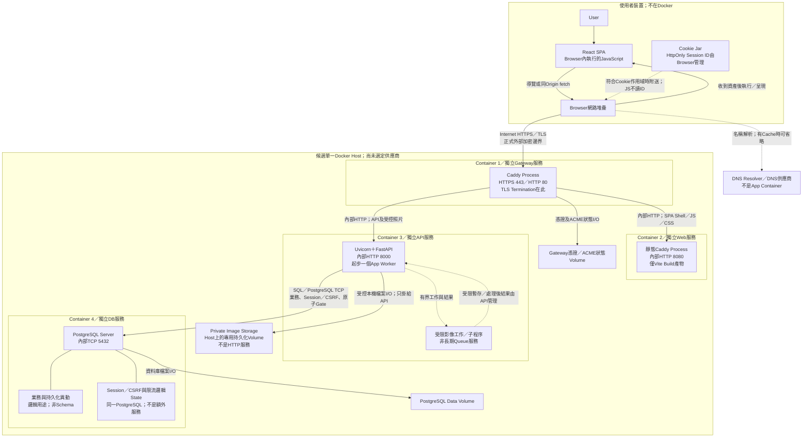
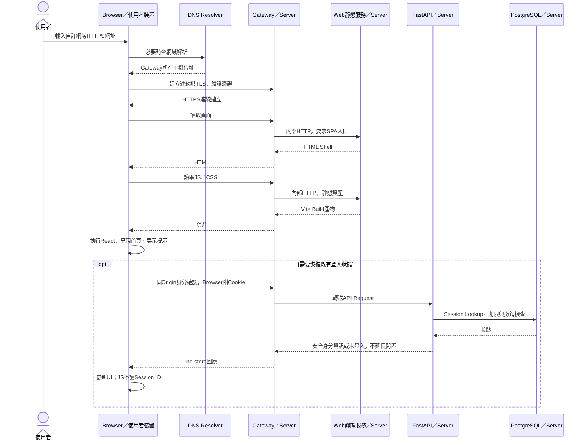
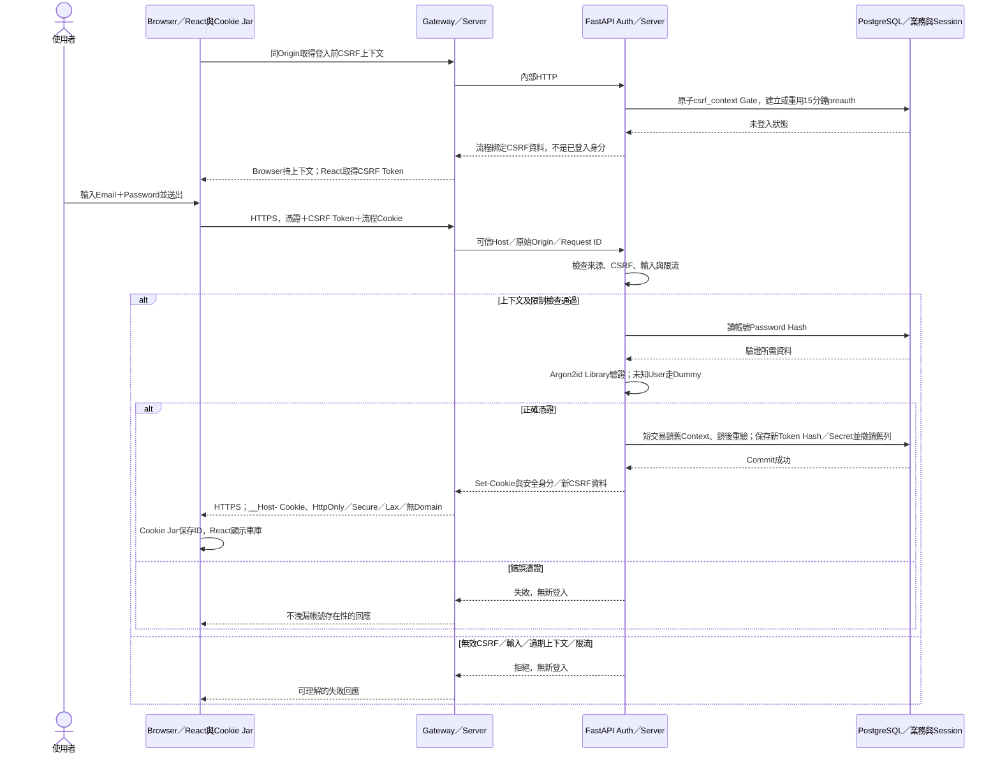
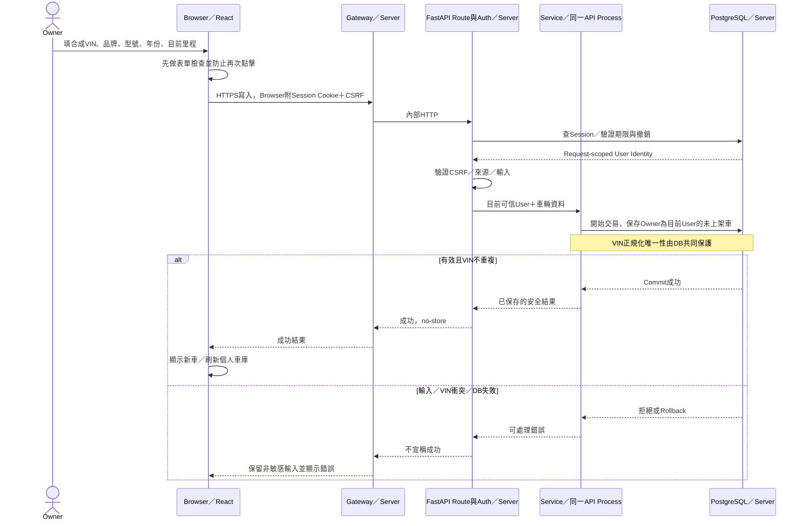
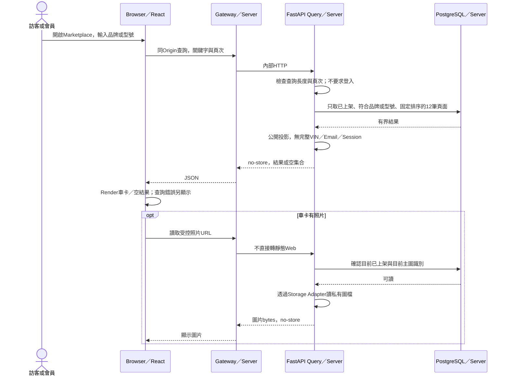
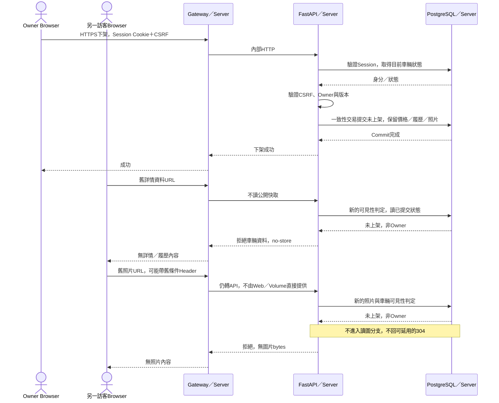
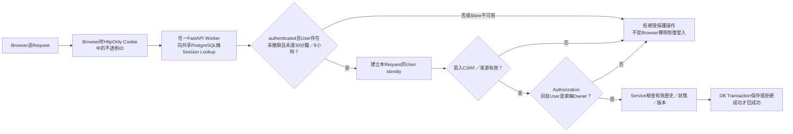
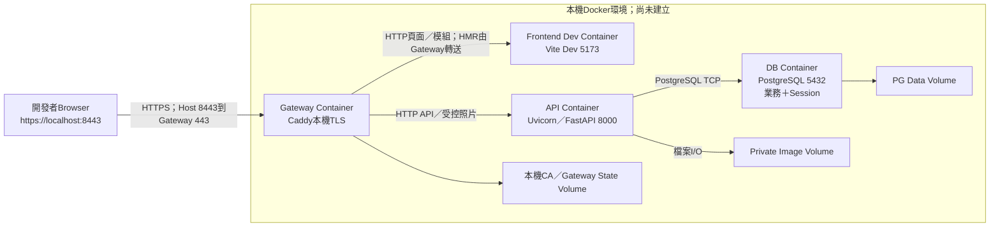
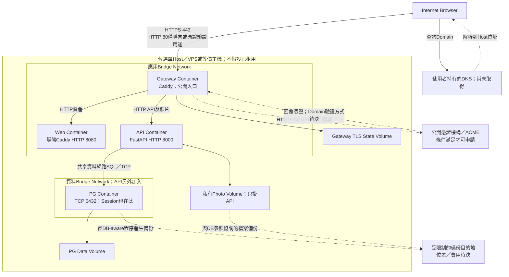

# Vibicle — High-level System Architecture Design

- 文件版本：v0.2，Step 2C.5 局部同步（保留Step 2A其他架構內容）
- 日期：2026-11-04（Asia/Taipei）；原版2026-11-02
- 需求基線：[PRD v0.2.1](PRD.md)、[DECISIONS §6](DECISIONS.md#6-step-2c5-design-reconciliation)、[Database Design v0.2](DATABASE_DESIGN.md)；AUTH_DESIGN v0.1審查來源保持不變
- 原程式基準：Vibicle commit `4ae1eff9880390a11d7b1f7d7952e18c61310253`
- 交付範圍：本輪只局部同步四份上游Markdown，整合CP-01～05及有條件CP-06；未寫程式、未建立Schema／完整Endpoint／Dockerfile、未安裝或部署
- 狀態：Architecture Proposal，尚未實際建置、安全測試、效能量測或驗證主機資源

## 0. 設計結論、證據與邊界

### 0.1 建議的最小架構

**建議用一個模組化 Python Backend，而非拆分多個業務微服務：React SPA → 同 Origin 的 Caddy Reverse Proxy → FastAPI → PostgreSQL；Session 同樣放 PostgreSQL，照片放 API 專用的 Private Volume。**

為忠實保留 PRD「Frontend 靜態服務與 Backend 為獨立服務」的候選要求，正式拓樸先畫成四個長期運行服務／Container：

1. Gateway：Caddy，公開 TLS 入口與反向代理。
2. Web：獨立靜態檔服務，建議也用 Caddy，但只在內部 HTTP 提供 Vite Build 產物。
3. API：Uvicorn 執行 FastAPI，一開始一個 Application Worker；API 內部分層，不把 Service／Repository 拆成網路服務。
4. DB：PostgreSQL，包含業務、Session 與持久化異動的邏輯資料。

Session Storage 是同一個 PostgreSQL 的邏輯用途，不是第五個 Container。Private Image Storage 是 API 掛載的持久化檔案空間，不是另外啟動一個 HTTP 圖片服務。影像處理可有受限子程序，但不因此增加 Celery／Redis／長期 Worker 服務。

若將靜態 Web 服務併入 Gateway，可減少一個 Container，React 與 Python 仍然分離；但會合併「獨立靜態服務」與 Gateway 的部署單位。此為較簡單替代方案，需先確認 NFR-DEP-01／CON-05 對「獨立服務」的驗收意義，不能在圖中默默合併。本提案維持四服務版本。

### 0.2 哪些是事實、提案、未定或未驗證

| 類別 | 內容 |
| --- | --- |
| 已存在的原始程式 | Next.js／React、Browser 直接 Sui 查詢與交易、Enoki／Wallet、Walrus 上傳；見第 1 節。不是新版實作。 |
| 本輪設計提案 | Vite SPA、FastAPI 模組化 Backend、PostgreSQL Session、Caddy 同 Origin 入口、獨立 Web、API 私有圖檔交付、單車一致性交易。 |
| 仍待部署決定 | 是否已有可用主機／網域、供應商、預算、DNS、TLS 驗證方式、磁碟、備份目的地及展示期限。圖中的主機只是候選，不假設已租 VPS。 |
| 尚未驗證的假設 | 單 Worker／PostgreSQL Session 可滿足展示工作量、影像每工作 5 秒／128 MiB 預算可用、主機可開必要 Port、可正確設定 Cookie／快取／憑證。均需後續驗收。 |

本文件只在架構層提出選擇，沒有把 SDQ 全部視為結案。CP-01～05的Auth選擇已接受、CP-06有條件接受；Library／版本、ORM／Driver、實際Proxy配置與完整Contract仍待後續，不能宣稱Cookie時序已驗證。

### 0.3 不可回退的需求

- 保留 FR-013：單事件、單鏈、完整替代內容、明確關聯、原文保留、一個有效末端，不增加審批／批次更正。
- 保留歷史補登：事件日期與申報時間分開；不同日期有效里程非遞減，同日不推定先後；目前申報里程 C≥有效最大值 H。
- 新增／更正歷史不自動改 C；下修 C 要理由、確認及持久化前後值。舊錯誤版本退出有效集合，仍可追查。
- 下架控制後續受控授權判定，不能追回既有副本或下架前已授權的傳輸。
- Session 閒置 30 分鐘／絕對 8 小時，撤銷本次 Session；HttpOnly 不代替 CSRF。
- 未上架只限 Owner；合成 VIN 唯一，公開末六碼；僅展示、不提供購買或聯絡功能。
- FR-006-AC03、FR-011-AC02／AC03／AC05 已停用；本文件提到它們只為標記禁止回退，不作現行驗收依據。

對應 PRD §4～5、DECISIONS D-02～11 及停用 AC 表。任何成本疑慮只在第 10 節提出，不修改需求。

## 1. 原始系統如何影響新設計

沿用本聊天 Step 0 分析，並重新閱讀以下固定 Commit 的相關原始碼。Workspace 沒有另存 Step 0 報告檔；本文件不假設存在該檔案，也不重新驗證原網站可用性。

| 原始證據 | 已確認的原行為 | 新提案承接的責任 |
| --- | --- | --- |
| [car-dapp/package.json:5–31](https://github.com/ntu-b12505041/vibicle/blob/4ae1eff/car-dapp/package.json#L5-L31)、[app/providers.tsx](https://github.com/ntu-b12505041/vibicle/blob/4ae1eff/car-dapp/app/providers.tsx) | Next.js／React，Provider 注入 Sui／Wallet／Enoki；原本並無 Python 業務 Backend。 | React 改用獨立 FastAPI，去除鏈上 SDK；Framework 不自動代替登入／授權設計。 |
| [hooks/useCars.ts:20–103](https://github.com/ntu-b12505041/vibicle/blob/4ae1eff/car-dapp/hooks/useCars.ts#L20-L103)、[app/market/page.tsx:8–9](https://github.com/ntu-b12505041/vibicle/blob/4ae1eff/car-dapp/app/market/page.tsx#L8-L9) | Browser 讀 Registry／全部 Car，再前端過濾並每五秒刷新。 | API／SQL 執行可見性、搜尋、固定排序及每頁12筆；不複製全量輪詢。 |
| [hooks/useUserAuth.ts:12–45](https://github.com/ntu-b12505041/vibicle/blob/4ae1eff/car-dapp/hooks/useUserAuth.ts#L12-L45)、[app/auth/page.tsx:50–85](https://github.com/ntu-b12505041/vibicle/blob/4ae1eff/car-dapp/app/auth/page.tsx#L50-L85) | 從 localStorage 恢復 zkLogin Session；Callback 產生 Proof／計算 Address。 | Cookie 只放 Session ID，Server 查 PostgreSQL 取得身分；不沿用 localStorage 登入判斷。 |
| [components/MintCar.tsx:46–120](https://github.com/ntu-b12505041/vibicle/blob/4ae1eff/car-dapp/components/MintCar.tsx#L46-L120)、[app/api/zkp/route.ts](https://github.com/ntu-b12505041/vibicle/blob/4ae1eff/car-dapp/app/api/zkp/route.ts)、[api/sponsor/route.ts](https://github.com/ntu-b12505041/vibicle/blob/4ae1eff/car-dapp/app/api/sponsor/route.ts) | Browser 上傳照片、組裝交易、取得 Proof／Gas、簽章後直接提交 Sui。 | FastAPI 從 Session 決定 Owner，驗證後提交 Database Transaction；沒有 Sponsor／Proof 流程。 |
| [vehicle.move:217–299](https://github.com/ntu-b12505041/vibicle/blob/4ae1eff/vehicle_contract/sources/vehicle.move#L217-L299)、[MyCars.tsx:57–88](https://github.com/ntu-b12505041/vibicle/blob/4ae1eff/car-dapp/components/MyCars.tsx#L57-L88) | Move 檢查 VIN 唯一、車主上下架與主動移轉；原下架清除價格。 | 依 PRD 實作唯一性／Owner／狀態規則；不提供過戶，且新下架保留售價，不能直接搬原邏輯。 |
| [vehicle.move:302–365](https://github.com/ntu-b12505041/vibicle/blob/4ae1eff/vehicle_contract/sources/vehicle.move#L302-L365)、[hooks/useCapabilities.ts:29–110](https://github.com/ntu-b12505041/vibicle/blob/4ae1eff/car-dapp/hooks/useCapabilities.ts#L29-L110) | 機構 Cap＋Registry 授權；紀錄里程不得低於目前值且同步更新目前值。 | 改為 Owner 自行申報／補登／關聯更正；採 PRD 新有效集合規則，不能恢復合約舊里程限制。 |
| [api/upload/route.ts:7–31](https://github.com/ntu-b12505041/vibicle/blob/4ae1eff/car-dapp/app/api/upload/route.ts#L7-L31)、[car detail:63–144](https://github.com/ntu-b12505041/vibicle/blob/4ae1eff/car-dapp/app/car/%5Bid%5D/page.tsx#L63-L144) | 代理到 Walrus，epochs=1；Browser 直接取得鏈上資料與附件 URL。 | 私有處理後圖檔＋API 每次授權交付；下架照片也拒絕新讀取。 |

原 Next.js API 是外部服務代理而非完整 Vehicle CRUD Backend；原 [api/execute/route.ts:8–24](https://github.com/ntu-b12505041/vibicle/blob/4ae1eff/car-dapp/app/api/execute/route.ts#L8-L24) 存在但 Step 0 未找到前端呼叫。沒有理由為新版保留一層 Next.js 中轉 Python。

## 2. Technology Decision Matrix

每一列依序說明 What、Why、How、代價、Alternative、Failure。這些是本輪推薦而非套件安裝清單。

| ID／What：候選選擇 | Why：具體優點 | How：Vibicle 用法 | 缺點／取捨 | Alternative：更簡單或其他選擇 | Failure：失效影響 |
| --- | --- | --- | --- | --- | --- |
| TD-01 React + Vite + TypeScript SPA | 把畫面與 API 責任清楚分開；型別幫助表單與回應維護；本案無 SSR／SEO 保證需求。 | Vite 在開發／Build 時工作；正式產物由 Web 交付，React 在 Browser 執行。 | 首次需下載並執行 JS；Router、API State、錯誤與身分恢復要自行整理；TS 不能驗證外部 Request。 | React + JS 可少型別設定但較易失配；Next.js 可提供 SSR，但多一套 Server Rendering 邊界；Vite 本身也能做 SSR，這裡只是選 SPA。 | Web／JS 載入失敗無完整互動頁；API 掛掉則顯示錯誤而非假空車庫。 |
| TD-02 Python + FastAPI | 符合 Python 限制與已有 Python 能力；路由驗證、Dependency 與 OpenAPI 有助解釋獨立 API。 | 一個模組化 API，以 Uvicorn 作 ASGI Server；Route／Auth／Service／Repository 仍在同一服務。 | Session、CSRF、交易與檔案並非自動完成；需管理 Python Runtime。async 不會使 CPU 圖像處理自動安全。 | Flask 可更少框架概念，但驗證／文件需補；Django 的內建帳號與後台較完整，但本案無後台需求；不擅自替換候選。 | API 故障時靜態頁仍可載入，但動態資料／登入／照片不可用；不能回退假資料。 |
| TD-03 不使用 Next.js API Routes 承載新版業務 | Python Backend 是要求；只使用 Next.js Route 不符合，另包 Python 又重複路由與信任邊界。 | Gateway 直接轉 FastAPI，沒有額外 Node BFF；保留 React，不保留 Web3 Proxy。 | 放棄 Next.js 整合式 Route／Rendering 的便利。 | 若作業沒 Python 限制，Next.js Route 可獨立完成一般 Backend；本案不採。若保留 Next 前端只為SSR，仍應讓Python掌管業務。 | 不引入此元件，因此沒有「Node中轉掛掉」的新故障點；Python 仍是動態服務依賴。 |
| TD-04 PostgreSQL | 已指定且能表達關聯、唯一性與多步驟原子更新，適合車、有效版本、Owner及稽核。 | 保存業務資料、登入狀態與持久化異動；Transaction 協調同車規則。 | 需備份、維護連線與容量；Transaction 本身不保證跨Request不變量，仍需並行策略。 | SQLite 減少服務但不符指定 Database，且不是這次替換方案；純記憶體不符合持久化。 | 單一 DB 故障使查詢、登入驗證與寫入失效；必須 fail closed。 |
| TD-05 Server Session 存同一 PostgreSQL | 沒有額外 Store 部署；多Worker共用撤銷與期限；能立即拒絕舊 Session。 | Cookie放不可預測ID；API查Store取得身分、期限及撤銷狀態；保存SHA-256 Token Hash及每Context獨立32-byte csrf_secret；preauth 15分鐘，authenticated閒置30分鐘／絕對8小時（CP-01／03）。 | 每次受保護請求增加DB查詢；Session清理與last-activity更新有成本；共用DB故障域。 | 記憶體Store最簡但依賴特定Process、重啟丟失；Redis適合明確TTL／負載需求，並非登入必要條件。 | API重啟可恢復查Store；DB不可用不得信任Browser或本機舊快取。 |
| TD-06 暫不加入 Redis | 工作量未量測，現有PostgreSQL已能保存共享Session；少一個服務與備份／TTL設定。 | Session與三Scope Fixed Window原子限流依CP-02共用PG，不以Cache／本機Counter作權威。 | 未利用Redis的TTL與高頻資料操作；若量測顯示DB負擔需再比較。 | 未來有大量Session／集中限流／Queue需求才加入；「改用本機dict」不是等價的共享Store簡化。 | 未部署Redis就沒有Redis故障；PostgreSQL仍為共同依賴。 |
| TD-07 Caddy Reverse Proxy + TLS | 同Origin入口集中路徑分流、TLS與HTTP導向；自動憑證管理可減少額外續期工具。 | Gateway對外HTTPS，內部依職責轉Web或API；不碰照片Volume／業務授權。 | 需正確DNS／Port／持久憑證資料／可信Proxy設定；自動TLS不等於免維運。 | Nginx＋明確憑證管理也可；已有受管理TLS入口可取代Caddy。直接暴露Vite／Uvicorn會分散TLS與路由責任，不是本提案首選。 | Gateway或憑證失效使整站不可達；後端仍運行也不代表使用者可連線。 |
| TD-08 獨立Web靜態服務，候選Caddy內部HTTP | 符合獨立Frontend服務邊界；可只換Build產物，不帶Python或照片秘密。 | Web只讀Vite輸出，回應SPA Shell／JS／CSS；內部不另申請憑證。 | 比Gateway兼任多一Container，但可用同種Caddy工具而非再加Nginx。 | Nginx只做靜態也合理；三Container合併方案見0.1，須確認PRD獨立服務意義。 | Web故障時API可被獨立驗收，但使用者拿不到新頁面／資產。 |
| TD-09 私有Docker Volume圖檔＋PG Metadata | 圖片串流／清理與DB交易資料分開；透過API驗證後交付，示範持久化且沒有公開桶。 | API專用掛載處理後圖檔；PG保存歸屬／有效照片識別等邏輯資訊，不在此定欄位。 | DB與檔案沒有共同ACID交易；主機磁碟狀態限制跨主機擴充，備份要協調。 | 很少圖片時用PG二進位資料也可，能簡化原子性與備份但增加DB大小／WAL／讀取負載；私有Object Storage可改善跨主機共享但增加服務與權限設定。 | 檔案遺失／磁碟滿可能只影響照片或上傳；不能錯顯上傳成功或刪掉舊主圖。 |
| TD-10 Docker單主機服務組合 | 可重現Runtime、網路與Volume生命週期；適合展示每層責任，不要求Kubernetes。 | 四個長期服務＋受限影像工作；DB、照片、Gateway狀態分別持久化。 | 主機仍是單點；Container不是獨立VM，也不自動備份／加密。 | 直接跑主機服務更少Container概念但不符Docker學習要求；Managed平台須確認支援持久化及網路，不先假設免費。 | 主機失效使全部服務中斷；刪Volume會丟資料，換Image不應如此。 |
| TD-11 輕量Service／Repository分層，ORM待選 | 將業務規則、HTTP與資料存取分離，方便一致性測試。 | Service持有交易邊界，Repository在同一DB交易中讀寫；ORM可用SQLAlchemy類工具，版本／Driver待後續。 | 過度抽象會讓學生追太多檔案；ORM不會自動解決Owner或單末端競爭。 | 直接參數化SQL＋少量Repository也可；不需Generic Repository、CQRS或每層獨立服務。 | ORM／SQL錯誤須Rollback，轉成可追查錯誤；不顯示內部查詢秘密。 |
| TD-12 有界影像處理工作，暫不建Queue服務 | 可終止超時／超記憶體的解碼，避免拖垮API；保留FR-012安全界線。 | API先驗證Owner／CSRF、接收有界輸入，交受限子程序／等價隔離工作，再切換有效主圖。 | 5秒／128MiB需實際校準；只有Thread Timeout不保證停止底層解碼；併行上限不能無界。 | 全部放API主程序最少概念但不符合可強制中止要求；外部Worker／Queue待真正負載需求再比較。 | 解碼工作失敗／被終止不切換主圖，清理暫存；API仍應能回應其他請求。 |

來源支持的工具能力：[Vite部署](https://vite.dev/guide/static-deploy)、[FastAPI Dependency](https://fastapi.tiangolo.com/tutorial/dependencies/)、[FastAPI Process／記憶體](https://fastapi.tiangolo.com/deployment/concepts/)、[PostgreSQL Isolation](https://www.postgresql.org/docs/current/transaction-iso.html)、[Caddy TLS](https://caddyserver.com/docs/automatic-https)。表中適用性與成本結論是依本PRD作的設計判斷，不是外部效能比較結果。

### 2.1 React SPA 與 Next.js SSR 的差別

| 問題 | 本提案React SPA | Next.js採用SSR時 |
| --- | --- | --- |
| 初次畫面在哪裡產生？ | Browser收到Shell與JS後執行React，資料另向API讀。 | Server可先產生帶內容HTML，再由Browser使互動部分可操作。 |
| 正式Server要執行React嗎？ | 不需為SPA每次Request執行React，只需交付Build靜態檔。 | 動態SSR需要Server執行環境；Next也能靜態產出，不是每頁必須SSR。 |
| 資料／身分界線 | Browser只能透過FastAPI，Owner仍由Server判斷。 | Server Rendering也要處理Session傳遞與資料權限；SSR不是授權替代品。 |
| 本作業的取捨 | 讓Browser、API與DB旅程清楚，符合無SSR／SEO承諾。 | 若需要首屏內容／搜尋引擎／分享預覽可評估，但本案多出非必要的Rendering與Cache知識。 |

Next.js仍是React框架；`use client` 不代表初次HTML一定沒有Server預先呈現。原專案業務查詢多在Effect中，不應因此把Next.js所有能力等同純SPA。參考 [Next.js Server and Client Components](https://nextjs.org/docs/app/getting-started/server-and-client-components)。

### 2.2 為何照片不放公開資料夾？PostgreSQL真的不能放嗎？

公開 `public/uploads` 或直接對外提供Volume／桶網址，通常讓靜態服務繞過Owner／上架狀態檢查。難猜檔名、短期Signed URL與Cache到期都不能取代本PRD的逐次授權界線。靜態Web服務只放程式資產，永遠不掛圖片Volume。

PostgreSQL可以保存二進位圖片，並非技術上禁止或天然不安全。若學生展示圖片極少，這是值得比較的簡化：照片與Metadata可在同一DB交易中保存，備份也一致。本提案選私有Volume，是為了清楚示範檔案生命週期、避免把影像容量與串流全交給DB；代價是必須處理第7.2節的跨儲存失敗。兩者都仍要經FastAPI授權，不論檔案存哪裡都不能直接公開原檔。

## 3. System Architecture Diagram 與執行位置

下圖為候選正式架構，不表示已經有VPS。所有內部Port只是通訊說明，不是設定檔；`/api/` 是候選職責分流前綴，不是完整Endpoint設計。圖片讀取也歸API路徑，不能落入SPA fallback。

### 3.1 Component、Process、Service、Container不是同一件事

| 名稱 | 本提案中實際是什麼 | 獨立網路服務？ |
| --- | --- | --- |
| React Component／Hook | Browser JS中的函式與UI狀態，不是Server Process。 | 否 |
| Vite | 開發Server／Build工具；正式Build不需要Vite持續運行。 | 開發時是；正式不是 |
| Web服務 | 將Build產物送到Browser的Server；沒有執行車輛業務。 | 是，候選Container 2 |
| FastAPI Application | Python程式與依賴，由Uvicorn Worker執行；框架不等於Container。 | 對外呈現一個API服務 |
| Auth／Service／Repository | API內的邏輯層／函式，不是三個Container。 | 否 |
| PostgreSQL | 有自身Process與持久化檔案的DB服務；不是ORM物件。 | 是，候選Container 4 |
| Session Storage | 存於PostgreSQL的邏輯狀態。圖中分開畫是為教學，不是另一DB。 | 否 |
| Private Image Volume | Docker Host提供給API的檔案空間。不是一個「Storage Container」。 | 否 |
| Docker Container | 由Image啟動、具檔案／網路等隔離的運行單位，可有Process與子程序。 | 不必然；本提案四個長期服務各一個 |

TLS在Gateway終止，Browser到Gateway加密；單Host內部Gateway→Web／API採HTTP，API→PG採私有網路TCP。這不是端到端TLS，也不把Docker Network當加密。若將DB或API移到其他主機，需重新評估加密、身份驗證與防火牆。

### 3.2 三種資料不要混放

- **程式資產**：HTML／hash命名JS／CSS，唯讀放Web Image，可依資產版本設定快取；SPA入口更新策略另設計。
- **業務／Session資料**：PostgreSQL，業務異動可追查、Session可撤銷；兩者備份／復原的安全語意不同。
- **車輛照片**：私有Volume，DB記其歸屬及目前有效識別；API授權後串流。車輛JSON與照片從首次回應設no-store，Web及Gateway不能偷偷快取。

## 4. Component Responsibility Matrix

| Component／位置 | 應負責的事 | 不應負責的事 | 邊界失守／失效時 |
| --- | --- | --- | --- |
| React／Browser | 表單、Loading／Error／Empty、導航、呼叫API、顯示來源及更正鏈；焦點／分頁事件重驗身分，清除舊請求結果。 | 決定可信Owner、持有DB秘密、讀HttpOnly ID、只靠隱藏按鈕授權、把全部車輛抓回才搜尋。 | UI可被使用者改寫，所以所有規則Server重驗；舊回應不能污染新登入。 |
| Web靜態服務／Container 2 | 交付Build資產；合法SPA導覽回入口HTML；不把API／圖片錯誤變成HTML成功。 | 執行React業務、接DB、掛照片Volume、保存Session。 | 頁面可能不載入，但不應洩漏圖檔／秘密。 |
| FastAPI Route／API Process | HTTP解析、資料型別／回應投影、呼叫依賴與Service、將結果／錯誤轉回HTTP。 | 每個Route複製完整里程規則、暴露ORM內部物件、未提交就提示成功。 | 非預期錯誤可Rollback與追Request ID，不回Stack Trace。 |
| Authentication Dependency／同一API | 讀Cookie、查Session、檢查到期／撤銷、建立Request-scoped Identity；可選身分用於公開讀取；CSRF檢查分開但共用上下文。 | 把「查到User」當作「可改任何車」、盲信Browser傳user_id、把User放全域變數作登入權威。 | Store不可用時拒絕受保護操作；不信任本機過期快取。 |
| Middleware／同一API | Request ID、記錄耗時、可信Proxy／Host等橫切檢查；不含全部業務授權。 | 在全域Middleware自行commit每個Service操作，或只因有Cookie就放行。 | Proxy資訊不可信會造成錯Origin／IP／限流，需明確信任來源。 |
| Service Layer／同一API | Owner／公開規則、C／有效歷史／更正鏈、上架條件、交易邊界、照片替換協調與異動稽核。 | 產生HTML、直接信任前端權限、將原履歷覆寫成新文、依申報時間推維修先後。 | 中途失敗須Rollback；同車操作不能繞過共同並行策略。 |
| Repository／ORM Layer／同一API | 在Service給的交易範圍內做參數化資料存取、取得鎖、版本比對及受限查詢。 | 各Repository自己分別commit導致半套更新、把ORM當安全機制、改成每層獨立API。 | DB例外向上轉可處理錯誤；不能留下半套更正版本。 |
| PostgreSQL／Container 4 | 持久化、唯一性／關聯約束、Transaction及共享鎖；業務與Session的權威。 | 自動理解使用者按鈕、替代所有里程Service規則、執行React或提供照片公開URL。 | 故障是共用單點；恢復須含業務資料與Session復原政策。 |
| Session Store／PG邏輯用途 | 共享Session身分／期限／撤銷資料；提供原子驗證／活動更新所需能力。 | 用清理Job時間當作授權期限、每次Request把已撤銷Session重新建立。 | 到期即拒絕，刪除過期資料只是容量管理。 |
| Reverse Proxy／Gateway | TLS終止、Host／路徑分流、HTTP→HTTPS、上游逾時／有界Body、必要Header與Request ID傳遞。 | 查車主、當作Database、直接公開圖片Volume、改寫錯誤成成功或無界Cache。 | 整站入口故障；502等須與業務錯誤區分。 |
| File Storage／API專用Volume | 保存處理後bytes與受限暫存；檔案可開啟／寫入／清理，沒有公用路徑。 | 判斷登入身分／上架狀態、自己發公開Signed URL、保證與PG共同ACID。 | 滿磁碟／缺檔要保留舊主圖並回可追查失敗。 |
| Image Work／受限子程序 | 有界解碼、轉正、重新編碼、去Metadata；工作完成才回結果。 | 處理無限制輸入、持有DB管理秘密、直接切換公開照片、保證辨識所有車牌／人臉。 | 逾時必須能真正中止，不只停止等待；主程序應存活。 |

FastAPI的Dependency是呼叫鏈注入／共用檢查機制，不是另外啟動的Server；參考 [FastAPI Dependencies](https://fastapi.tiangolo.com/tutorial/dependencies/)。

## 5. Request Lifecycle Sequence Diagrams

五圖皆以正式候選拓樸表示。Browser欄包含其中執行的React與Cookie Jar；Gateway／Web／API／PG都在Server。Auth／Service如在圖中分開，仍是同一FastAPI Process。動作名稱不是已定版Endpoint。

### 5.1 第一次輸入網址到看到React首頁

頁面Shell不需要PG參與；只有動態身分／資料查詢才會進API／PG。靜態頁可載入不表示動態系統健康。SPA深層連結也需Web回入口HTML，但API與圖片路徑不可套用這個fallback。對應 FR-002／FR-010-AC04、NFR-DEP-01～03。

### 5.2 使用者登入

登入前Anti-CSRF狀態不是登入；已採kind=preauth、user_id=NULL、絕對15分鐘、獨立Secret，來源／Gate先驗（CP-01～03）。普通有效Context重取不重發Cookie；Login／Bootstrap Cookie流程分別在候選Lifecycle Lock內，不持鎖等待User輸入，詳細與未解競態見AUTH §6／7及本文件§6.5。註冊後仍須手動登入。此圖的失敗分支是總括：若CSRF／輸入先失敗，不會繼續驗密碼或建立Session；PG不可用時不能登入，也不回退到Process本機User。對應 FR-001／002、BR-13／14、SDQ-01／05。

### 5.3 使用者新增一台車

若Auth／CSRF先失敗，流程在進入Service前終止。建車可以沒有售價／照片；照片是另一個授權操作，不能暗中恢復原MintCar「先上傳才能建車」規則。Request傳來的Owner不能覆蓋Session身分。對應 FR-005／012、NFR-DAT-01、BR-01／04／05。

### 5.4 Marketplace搜尋

查詢不需要登入Cookie才能成立；若帶無效Cookie，不能因此得到Owner私有投影。上述照片可讀只是正常分支，DB／檔案故障回失敗或占位資訊，不能繞過狀態檢查。對應 FR-009／010／012，SDQ-04；保持日期與上架排序不同，補登／更正不刷新上架時間。

### 5.5 下架後以舊網址讀詳情／照片

直接開舊「頁面網址」仍可能取得公開SPA Shell；被拒的是私有車輛JSON／履歷／圖片，不是通用程式碼。已在下架前完成授權的串流、已下載或外部副本不能回收；Owner自己的有效Session仍可讀未上架內容。可見性判定不能用長交易舊快照／Read Replica延遲／本機Cache繞過新狀態。對應 FR-008-AC01／04／05、NFR-SEC-08。

## 6. Stateless Application Server、Server-side Session 與 JWT

### 6.1 三個不同層次

1. **HTTP的Stateless特性**：協定不因同一使用者前一次請求，就自動替下一次請求記住登入身分。Cookie是Browser攜帶的應用層識別資料，讓Server能重建上下文；不會把HTTP本身變成有內建登入狀態的協定。參考 [MDN HTTP Overview](https://developer.mozilla.org/en-US/docs/Web/HTTP/Guides/Overview)。
2. **Stateless Application Server**：FastAPI不把「誰已登入」只留在某一Worker的RAM。請求帶來Session ID，任一合格Worker都可查同一Store、取得身分，再做授權。Process仍有Request物件、連線Pool或設定，並不代表完全沒有記憶體狀態。
3. **Stateful Server-side Session**：每個登入的User對應、建立時間、最近有效活動及撤銷狀態保存在Server控制的共享Store。本案建議PostgreSQL。這是整個系統的狀態，不要求某個API Worker持有它。

所以「API登入判定不依賴本機RAM」與「Server保有Session」並不矛盾。系統整體仍有DB與檔案狀態；不能因API這一層無本機登入權威，就宣稱全部元件Stateless。

### 6.2 受保護寫入的流程圖

此圖是邏輯授權順序，不承諾FastAPI一般Dependency必早於Body Parser；來源／Header CSRF與有界接收的早期Guard須按AUTH §5.5及2D路由Policy實作／測試。此圖只畫受保護寫入。公開Marketplace與已上架詳情不要求登入，但仍要查可見性；未上架讀取才需要有效Owner身分。Cookie內的ID不是User ID，改成別人的車輛識別也不會因此得到權限。

### 6.3 同一請求打到不同Worker為何可辨識使用者？

假設請求1到Worker A，請求2到Worker B：兩者使用相同Store配置與資料來源，都依Cookie ID查PostgreSQL。Session不存在／到期／被撤銷就拒絕；User Identity只存在各自Request範圍，不能沿用前位使用者的全域變數。因此登入不需要Sticky Session。

本提案起步仍只一個Worker，避免未量測先擴充；設計要容許將來多Worker共享Store，而不是用本機dict。增加Worker後，連線Pool數量、限流、影像工作總併發也要一起調整。FastAPI文件說明Process通常不共用RAM，因此本機Session或Counter不能當跨Worker權威。參考 [FastAPI Deployment Concepts](https://fastapi.tiangolo.com/deployment/concepts/)。

照片存在Host Volume，表示API雖無本機登入狀態，整個部署仍依賴特定主機磁碟。多Worker在同Host可共用Volume；多Host則要私有共享儲存或重新設計，不能直接複製Container就宣稱可水平擴充。

### 6.4 Authentication比較

| 面向 | 本機RAM Server Session | 共享PostgreSQL Server Session：本案推薦 | 以簽章JWT作Access Token |
| --- | --- | --- | --- |
| 請求憑證 | 不透明ID，需找持有RAM的Process | 不透明ID，任何Worker都查同Store | Token內有Claims與簽章，驗證者可用Key驗證 |
| 每次身分判定 | 讀本機Session | 查共享Session的期限／撤銷／User | 可只驗簽與到期；若要即時撤銷／閒置則通常仍需共享狀態 |
| Process重啟 | Session消失，必須安全重登 | Store持久化則可繼續，原始期限不延長 | Key／政策不變則Token可能仍可用 |
| 本次登出立即失效 | 可刪RAM，但另一Process未必知道 | 撤銷共享Session，後續新判定拒絕 | 只刪Browser Token不夠；需拒絕清單／版本／Session關聯，或等Token到期 |
| 閒置30分鐘＋絕對8小時 | 能做但不易共享 | Store維護last activity與建立時間，直接對應需求 | 固定exp不等於滑動閒置；需額外活動追蹤 |
| Cookie與CSRF | 若Cookie自動附送，需CSRF | 需CSRF；HttpOnly不代替 | JWT放Cookie一樣有CSRF；JWT不是自帶CSRF防護 |
| 適合這次？ | 不推薦，和Stateless Worker／重啟目標衝突 | 符合可撤銷、可理解及減少服務的需求 | 能實現，但額外機制沒有減少這份PRD的複雜度 |

JWT是Token格式／驗證方式，不等於OAuth、不是自動加密，也不是只要用了就能稱應用Stateless。本輪不改PRD的Server-side Session；JWT只作比較。

特別注意：Starlette內建的 `SessionMiddleware` 是簽章Cookie式Session，不等於「PostgreSQL Server-side Session」。不能只加這個Middleware就宣稱完成本PRD的共享撤銷機制。候選Library或小型Store Adapter須在SDQ-01審查，不能自製密碼雜湊／亂數演算法。參考 [Starlette SessionMiddleware原始碼](https://raw.githubusercontent.com/Kludex/starlette/main/starlette/middleware/sessions.py) 的Cookie序列化／簽章行為；實際套件版本仍待選定。

### 6.5 Session生命週期與CSRF的高階設計（CP整合）

以下回填CP-01～05及有條件CP-06；完整已審查來源是AUTH §3～6，Model與SQL界線依DATABASE_DESIGN §4.2／4.8／8／Q-06／Q-10，沒有建置服務。

- **帳密／Store**：Email normalized→PG lower、Unique／Lookup同語意，Argon2id Library保存Password Hash；版本、PG UTF-8／Collation／Locale與Unicode實測仍須記錄。Cookie raw Token由CSPRNG產生32 bytes、PG只存SHA-256；csrf_secret另獨立32 bytes，無共用Default／Index（CP-01／04）。
- **Context／Rotation**：preauth無User、絕對15分鐘、last=created且不Touch；authenticated有User、閒置30分鐘／絕對8小時。Login新列／新Token／新Secret與舊Context撤銷同交易，禁止原列升級；註冊不登入（CP-01／03／05）。
- **Cookie**：Production __Host-vibicle_session，Secure／HttpOnly／Lax／Path=/／無Domain；authenticated Max-Age=28800、preauth=900。必要Bootstrap／成功Login／確認Logout才Set／Clear；一般API／me／Touch／失敗不重發Cookie，SID不入JS／URL／Log（CP-05／06）。
- **CSRF／來源**：Synchronizer Token由受控HTTPS no-store回應供JS記憶體、Mutation回X-CSRF-Token與同Context作常數時間比較；涵蓋Register／Login／Logout／車輛／C／上下架／補登／更正／上傳。固定PUBLIC_ORIGIN精確匹配，Origin缺失才Referer、全缺拒；Mutation／Bootstrap若有Sec-Fetch-Site只接受same-origin。Native Client需Jar／Token／合法Origin；不因同Origin／SameSite／CORS略過（CP-01／06）。
- **限流**：同PG Fixed Window三Scope：login20／固定300秒、register10／固定3600秒、csrf_context60／固定300秒；UTC Epoch對齊、HMAC可信來源、原子UPSERT、N＋1起429／Retry-After；Gate獨立Commit，PG故障不放行。保留Burst／NAT／分散來源及Proxy實測風險，不等同Sliding（CP-02）。
- **Touch白名單**：完整授權且成功的管理Mutation／管理No-op、Owner主動車庫／管理詳情／完整履歷讀取可Touch；Public頁／搜尋、me／csrf、圖片／靜態、背景輪詢／預抓、拒絕／未成功請求不可。No-op不洗刊登時間／車輛版本，MVP不自動輪詢Owner讀取（CP-05）。
- **Touch／Commit**：業務Transaction結束後另用短Session交易；鎖後取新Clock驗kind／revoked／idle／absolute，才條件更新非倒退last。不得變created／absolute／Secret、清revoked或UPSERT。業務已Commit但Touch失敗／過期時，回應保留已保存事實、另說明重驗，不誘導盲重送；2D須定回應Metadata（CP-05）。
- **Logout**：只撤銷當前Context；Q-06仍只接受有效authenticated。專用Logout可驗保留的過期／已撤銷authenticated列＋原CSRF／來源來確認撤銷／清Cookie，不能因此讀Private／Touch；未知／已清理或過期preauth需新安全Context。確認Commit後才宣告完成；其他裝置不變（CP-05）。
- **UI／在途邊界**：Auth Epoch＋User綁定與BroadcastChannel清State／Cache／可控預覽；通知送達可執行Tab後≤5秒，焦點／BFCache恢復先遮蔽重驗。撤銷Commit後的新認證拒舊ID；已先授權工作不回溯取消。普通舊Response無Set-Cookie，但舊Auth Response仍可能先被Browser套用Cookie（CP-06）。
- **CP-06條件風險**：Web Locks只為受控Auth Lifecycle候選，不能管所有外部／非受控請求；忽略JSON／Abort不取消Set-Cookie或Server工作。Timeout／結果不明不假定沒成功，也不以單次me匿名證明先前Login已結束；Chromium、多Tab、凍結、網路逾時／重排均須驗證。若不能滿足FR-002-AC06／07、FR-003-AC05，標Design Risk DR-01並補設計，不降低AC。
- **故障／Restore**：PG故障fail closed，不用本機身分／計數替代；正常重啟沿用原期限，Backup Restore先在隔離下失效全部Session／preauth再開入口。

參考：[OWASP Session／CSRF](https://cheatsheetseries.owasp.org/cheatsheets/Cross-Site_Request_Forgery_Prevention_Cheat_Sheet.html)、[AUTH_DESIGN](AUTH_DESIGN.md)；接受設計不等於安全測試通過。

## 7. Stateful資料、一致性與照片交付設計

### 7.1 履歷更正仍是Must Have：高階交易邊界

目前申報里程C、有效事件集合E、H與原文／更正鏈語意完全沿用PRD §5.1。本提案建議以「同一車輛的一致性邊界」序列化影響規則的寫入，而非在單一Python Process放Lock。

高階步驟：

1. Auth／CSRF通過後，Service開始Database Transaction，取得代表該車的共同排他控制。候選為PostgreSQL中該車既有資料列的Row Lock；具體映射在ERD階段決定，這裡不建立Table／Column。
2. 取得控制後再讀取最新Owner／車輛版本／C／有效事件及目標末端；不能先用舊集合驗證、排隊後直接寫入。
3. 補登按事件日期界線驗證；更正先在候選集合排除該事件原有效版，再加入完整替代內容，檢查跨日非遞減與C≥H；不自動修改C。
4. 原文保留，更正版新增與有效末端切換一起提交；C下修另有理由／前後值。更正針對非末端或舊版本必須衝突，不改成偷偷更正新的末端。
5. 同車補登、更正、C更新、一般編輯、上下架及主照片Metadata切換都使用一致的控制／版本政策；跨車操作不需全站大鎖。多鎖順序、短交易、等待逾時與死鎖處理須在SDQ-02定版。
6. Commit才回成功。Transaction失敗Rollback；連線斷掉而結果不明時先讀回，不盲目重送，通用Idempotency仍未升級為Must Have。

**Row Lock與版本比對不同**：Lock避免兩個執行中的同車操作共同破壞規則；版本比對防止使用者拿「幾分鐘前看過的舊資料」蓋掉新內容。兩者不能互相假冒。DB唯一性仍保護Email／VIN與單末端需要的限制，具體Constraint不在本階段建立。

PostgreSQL預設Read Committed的每個Statement可看到不同快照；「有Transaction」不等於所有跨紀錄規則自動安全。若採上面的共同鎖，必須在取得鎖後讀／重驗，並讓所有影響不變量的Writer遵守。另一候選是Serializable＋重試，但需處理序列化失敗；本案較容易解釋的是同車短交易控制。參考 [Transaction Isolation](https://www.postgresql.org/docs/current/transaction-iso.html)、[Explicit Locking](https://www.postgresql.org/docs/current/explicit-locking.html)。

PRD的競爭例子：1月50,000／3月70,000，兩Request分別補2月10日65,000與2月20日60,000；它們各自對舊集合可能通過，合併卻倒退。鎖住同車後第二方必須重讀已提交的新集合並拒絕矛盾，不能以「每個INSERT都成功」當驗收通過。

這是必要的一致性成本，不是需要Event Sourcing或多個微服務的理由。FR-013的追加原文不等於要引入事件匯流排；一般關聯式版本模型可以承接，具體ERD留下一階段。

### 7.2 圖片與DB無共同ACID：保住舊圖的候選流程

1. 先驗Session／CSRF／Owner與Body限制，把原始檔接入受限、非公開暫存；不以客戶端路徑或檔名定位任意檔案。
2. 受限工作檢查5MiB、各邊6000px／總1200萬px、單靜態影像，轉正、重編碼、移除EXIF／GPS／XMP／IPTC及非必要文字Metadata，驗證處理後檔亦≤5MiB。
3. 處理後bytes先保存成新的不可公開儲存識別，確認可讀；不要覆寫舊檔。此耗時處理不持有長DB鎖。
4. 再開短DB交易，重查身分／Owner、主照片版本及車輛當前狀態，切換有效識別並Commit。若處理期間Session已過期／下架／另一替換已提交，要按當前規則處理，不能拿舊檢查直接覆蓋。
5. Commit成功後，舊識別立即不再通過API「目前有效主圖」檢查；物理清理可稍後做。失敗保留舊有效主圖，清理新孤立檔／原檔暫存。
6. 崩潰可能留下孤立新檔，但不應讓DB指向從未保存的檔案；清理／備份須考慮此狀態。DB已Commit卻回應遺失時仍要先查結果，不重複宣告失敗並自動替換。

PG Commit與檔案保存不能變成一個普通DB Transaction；即使使用檔案重新命名，也沒有跨PG與Filesystem共同ACID。若日後比較PG二進位存圖，可以簡化這部分，但要重新評估容量／備份，不能在此直接更換方案。

影像工作預算沿用候選5秒／128MiB，採可真正終止的工作邊界，不能只用HTTP等待逾時。具體OS限制／工具與總併發待SDQ-03、DPQ-03；一個Worker不等於不可能同時收到多個上傳，候選先有界排入工作或拒絕忙碌，不引入無限制RAM Queue。參考 [OWASP File Upload](https://cheatsheetseries.owasp.org/cheatsheets/File_Upload_Cheat_Sheet.html)。

### 7.3 每次讀圖都必須先授權

FastAPI根據照片識別在PG確認它仍是該車目前主圖，再判定「車已上架，或有效Session的User是Owner」；通過後才由Storage Adapter開啟私有檔串流。不把Filesystem路徑、Object Storage秘密或可獨立存活的公開Signed URL交給Browser。

同樣規則涵蓋詳情、舊履歷版本、C下修摘要、如有提供的縮圖、HEAD／Range／條件請求。先授權，不能先回304；本MVP可不實作部分讀取／縮圖，但不能讓Framework預設路徑繞過。API／Gateway／Web都需驗收no-store，且照片Volume只掛API，不掛Gateway／Web。

不使用長時間快照或延遲Replica判斷新的可見性；API在下架Commit後的新授權要讀Primary的當前已提交狀態。此界線與PRD一致，不包含撤回先前已授權的串流或外部副本。參考 [MDN Cache-Control](https://developer.mozilla.org/en-US/docs/Web/HTTP/Reference/Headers/Cache-Control)；Header不會清掉所有既存內容。

## 8. Local／Production Candidate Topology（只設計）

### 8.1 本機開發：維持同Origin與TLS語意

建議開發時也先採單一Browser入口，例如 `https://localhost:8443`，Gateway代理Vite Dev與API。用本機CA憑證並在開發者裝置明確信任；這是之後的設定工作，本輪不安裝或匯入憑證。容器內產生CA不表示Host Browser已自動信任它。

開發差異：Web服務由Vite Dev取代正式靜態Caddy，提供模組更新／HMR；Browser仍只向Gateway同Origin連線，HMR需要相應WebSocket代理設定，留待後續驗證。程式碼可用Bind Mount支援開發，但不在此建立掛載設定；DB與照片用持久Volume。

本機只向loopback發布Gateway的測試入口；不必向LAN公開API／DB／Vite。若暫用純HTTP開發，需要明確的dev-only Cookie政策，不能把Secure關閉帶到正式環境，也不能用該環境宣稱通過TLS／Cookie安全驗收。本提案的主要驗收拓樸仍是上圖HTTPS，不依賴這項例外。

`localhost`在Browser是使用者電腦，在API Container則是該Container，不能用API內的localhost代表另一個PG Container。容器間應用Docker Network的服務名稱／別名，這與公開Domain是兩套解析範圍。

### 8.2 候選正式拓樸：一台Host也可適用

Network成員的精確意思：Gateway／Web／API共用應用網路；API另外加入資料網路，PG只加入資料網路。圖中API只畫一次，不是兩個Process。兩個Bridge Network是簡單隔離提案，不是兩台主機；Host管理者與Docker管理權仍有能力接觸它們。

| 服務 | 候選內部監聽 | Host／Internet發布 | 可持久化內容 |
| --- | --- | --- | --- |
| Gateway | HTTP 80／HTTPS 443 | 正式僅公開必要80／443；主機管理入口另受限制 | TLS私鑰／憑證與ACME狀態 |
| Web | HTTP 8080 | 不直接公開 | Build產物在Image，通常不需資料Volume |
| API | HTTP 8000 | 不直接公開，Gateway轉送 | 圖片Volume；業務／Session不放Worker RAM |
| PostgreSQL | TCP 5432 | 不直接公開；本機若要Debug需另設受限臨時入口 | DB Volume，含Session與業務／更正／異動 |
| Photo Volume | 無Port | 無公開File Server | 處理後主圖；原檔暫存有界並清理 |

80／443、Docker預設路由與防火牆仍需實測，不能因沒寫公開Port就省略發布前網路檢查。Docker Port Publishing與Bridge行為參考 [Port Publishing](https://docs.docker.com/engine/network/port-publishing/)、[Bridge Network](https://docs.docker.com/engine/network/drivers/bridge/)。

### 8.3 Docker與設定的具體意義

| 概念 | What／Vibicle用法 | 不能誤解成什麼／Failure |
| --- | --- | --- |
| Image | 打包Runtime與程式／靜態產物的版本化範本；Frontend Build先完成，正式Web Image只交付產物；Backend Image包含Python應用。 | 不是正在運行的服務，也不應包含上傳照片、Production Secrets或DB資料。Build錯誤無法靠換Container補救。 |
| Container | 從Image啟動的運行實例，具Process與隔離空間；一個API Container起步一個Application Worker。 | 不等於一個React Component或必然只有一個OS Process；刪除可寫層不應刪持久資料。 |
| Network | 容器間私有通訊與名稱解析；API用PG服務名稱連線。 | 不是HTTPS或身份驗證；Network隔離配置錯誤會暴露內部服務或造成無法連線。 |
| Port Mapping | 將Host Port轉給Container Port；本機8443→Gateway443、正式443→Gateway443是候選例子。 | Browser不直接知道api:8000等容器名稱；未發布Port不等於Host管理者無法存取。 |
| Volume | 生命周期獨立於Container的持久資料空間；分開保存PG、照片、Gateway狀態。 | 不是備份，也不是跨Host自動共享；刪除Volume／Host磁碟損毀仍會丟失。 |
| Environment Variables | Runtime非秘密設定，如允許的公開Origin、內部DB位置、儲存位置、模式與限制。 | 所有Frontend Build中可供Browser讀取的設定都視為公開；不能放DB密碼、Session秘密或CA私鑰。 |
| Secrets | 由Runtime受限檔案或主機管理流程供應DB密碼／必要密鑰；具體方法待DPQ／SDQ。 | 不寫入Image Layer、Git或日誌；單純叫.env不代表安全，也不能讓dev設定改掉正式Secure。 |

Docker概念依據：[Image](https://docs.docker.com/get-started/docker-concepts/the-basics/what-is-an-image/)、[Volumes](https://docs.docker.com/engine/storage/volumes/)；此處尚未建立任何Build或Compose檔案。

### 8.4 DNS、Certificate、TLS Termination與服務不是一件事

- **Domain／DNS**：先持有Domain並能改DNS；A／AAAA等紀錄將名稱指到可到達的部署入口。DNS不保存React程式，不把不同URL Path分流成不同API；TTL也代表改紀錄不一定立即傳播。
- **Certificate／TLS**：Browser驗證憑證與網站名稱，建立到Gateway的加密連線。Certificate不是網站主機、也不存車輛資料；TLS無法代替Owner／CSRF。
- **Caddy自動HTTPS**：能在條件滿足時處理簽發／續期；仍需Domain控制、正確DNS、可到達驗證入口、必要網路及可持久寫入的狀態。不能因選Caddy就宣稱現有免費Domain／憑證已完成。
- **TLS Termination**：Gateway解密外部HTTPS，再用單Host內部HTTP代理Web／API。API從可信Gateway取得原始Host／Scheme／來源資訊，避免誤判Origin；不能信任任意客戶端Forwarded Header。
- **Reverse Proxy不是Redirect**：反向代理在Server內轉送，Browser仍看同一公開Origin；Redirect則請Browser再訪另一個URL。API不應Redirect到容器內部名稱。

本機CA通常需要額外信任設定，尤其Caddy運行在Container時不會自動修改Host Browser Trust Store。來源：[Caddy Automatic HTTPS／Local HTTPS](https://caddyserver.com/docs/automatic-https)、[Caddy Reverse Proxy](https://caddyserver.com/docs/caddyfile/directives/reverse_proxy)。

### 8.5 持久化、重啟、備份與恢復

| 情境 | 設計預期／限制 |
| --- | --- |
| API正常重啟／換Image | 業務與Session在PG、照片在Volume；API重新讀Store，不延長Session原期限，不靠Process RAM認定登入。 |
| PG正常重啟、資料Volume保留 | 正常已提交資料與Session由DB持久化復原；中斷中的請求可能結果不明，先查結果，不自動重送。具體DB安全／Durability設定需後續核對。 |
| PG服務不可用 | 靜態Shell仍可取得，所有需要DB的業務／Session判斷失敗，私有圖檔不能因磁碟還在就無授權交付。 |
| Volume被清除／Host磁碟失效 | 不是可宣稱無損的普通重建；需從備份還原，無備份就可能永久遺失。 |
| 還原舊DB備份 | 還原可能帶回先前尚未撤銷的Session；建議在重新開放入口前讓所有Session／登入前CSRF上下文失效，要求重登，不復活舊憑證。這是災難恢復，與正常「只登出目前Session」不同。 |
| DB與照片備份 | 用DB-aware備份配合有效照片參照；最簡單候選是在受控維護期間暫停寫入再備份二者。不能邊寫邊直接複製PG資料目錄就宣稱一致。 |
| 備份驗收 | 在獨立測試環境還原帳號、有效事件／更正鏈、C異動與照片，確認無失效Session復活、無公開圖檔旁路；目的地、保留期限與可接受停機待DPQ-04。 |

備份方法與前提參考 [PostgreSQL Backup and Restore](https://www.postgresql.org/docs/current/backup.html)。單Host只能做到可重現、持久化與可恢復，不是高可用。若主機或PG同時失效，本案沒有自動容錯承諾。

## 9. Security and Trust Boundaries

### 9.1 邊界與責任

| 信任邊界 | 可相信什麼／不可相信什麼 | 架構控制與驗收關聯 |
| --- | --- | --- |
| User輸入→Browser／React | UI State／隱藏按鈕都可被使用者修改，不能當Owner證明。 | FastAPI重驗身分、輸入、來源、Owner與版本；FR-005／006／011／013、SEC-02。 |
| Browser→Gateway | 公網不可信；TLS加密傳輸不驗證業務身分。 | 有效Certificate、HTTPS、Host限制與Body／逾時邊界；CON-06、SEC-04。 |
| Gateway→API | 只信任明確Gateway傳來的原始Scheme／Host／必要來源資訊。 | API不直接公開；可信Proxy與允許Origin明列，不能接受任意客戶端Forwarded Header；SDQ-01、DPQ-02。 |
| Cookie→Session Lookup | Cookie ID是Bearer性質的識別秘密，不因存在就有效。 | PG查期限／撤銷／User，無效或Store故障fail closed；不把ID寫Log；FR-002／003、SEC-01／03。 |
| 已識別User→車輛資源 | 登入不是對任意車輛／照片／舊版紀錄的授權。 | 服務端Owner／公開規則，查詢投影不漏Email／完整VIN；FR-004～013。 |
| 不可信Request→Mutation | HttpOnly不防Browser自動附Cookie的CSRF；同Site也不等於同Origin。 | 流程綁定Token＋來源驗證，含登入／註冊／上傳；SEC-07、SDQ-01。 |
| API→PG | Runtime角色不應擁有任意系統管理權；ORM不自行保證規則。 | 參數化查詢、必要權限、交易／唯一性、原文追加與持久稽核；DAT-01～05。 |
| API→Filesystem／解碼器 | 檔名、路徑、Content-Type與壓縮大小不是可信內容。 | 受控識別與根路徑、像素／解碼工作限制、去Metadata、私有Volume，不能Path Traversal或公開原檔；SEC-06／09。 |
| Server回應→Cache／畫面 | no-store限制受控快取，不刪除外部副本；已Render資料仍在畫面。 | 受控入口逐次授權、焦點重驗、登出／帳號切換清State，舊請求結果隔離；SEC-08、FR-008-AC04。 |
| Runtime→運維／備份 | Host／Docker管理者能接觸秘密與資料，不是零信任。 | 受限Secrets／備份目的地、不公開DB／原檔、還原後撤銷舊Session；SDQ-06、DPQ-04。 |

短暫保留資料以Render畫面，與將HTTP／照片持久化當成可繞過新授權的Cache不同。React不能用舊Query Cache在頁面恢復時直接呈現私有資訊；先查身分／可見性，已知登出／下架後清除。此解讀遵守PRD對已交付畫面不能全域追回的界線，不是悄悄取消no-store。

### 9.2 前後端分離不必然造成CORS

Origin由Scheme、Host、Port決定，不由Process、Docker Container或URL Path決定。以下只是教學例子，不是已取得的Domain：

| Browser看到的URL關係 | 是否同Origin | 含義 |
| --- | --- | --- |
| `https://vibicle.example/` 與同Host的API Path | 是 | Gateway內部再轉兩個服務，Browser沒有跨Origin，不需為此開放CORS。 |
| 同Host的照片API Path與SPA Path | 是 | Browser可同Origin發請求，仍須Server可見性檢查；不是靜態公開圖。 |
| `http://localhost:5173` 與 `http://localhost:8000` | 否 | Port不同，若Browser直接跨Port讀API，就要設計CORS；可用開發Gateway避免。 |
| `https://app.example` 與 `https://api.example` | 否 | Host不同；Cookie Scope／CORS／CSRF要一併重審，不因同一台主機就消失。 |

CORS主要是Browser跨Origin讀取回應的政策，不是API身分或Owner驗證，也不可靠它單獨阻止所有跨站寫入。伺服器間HTTP代理與獨立HTTP Client不靠Browser的CORS保護；有Cookie的跨Origin回應也不能用萬用允許來源作簡化。參考 [MDN CORS](https://developer.mozilla.org/en-US/docs/Web/HTTP/Guides/CORS)。

### 9.3 不引入新業務能力

只做合成資料的履歷與出售資訊展示，不因加入Session或更正鏈就暗示Email／車籍／機構驗證。上架／下架是可見性狀態，不是訂單、成交或過戶；沒有金流、站內聊天、聯絡賣家或Admin特權。

## 10. Risks and Trade-offs

| Risk ID | 風險／取捨 | 本提案的處理與代價 | FR／NFR／SDQ／DPQ |
| --- | --- | --- | --- |
| R-01 | Session Store與業務同PG，是共同單點 | API重啟可恢復共享狀態；PG掛掉就拒絕驗證／動態資料，不加記憶體fallback。少一Redis服務的代價是共享故障域。 | FR-002／003；REL-03；SDQ-01、DPQ-01／04 |
| R-02 | 還原舊DB可能復活已撤銷Session | 受控恢復流程先失效全部Session／登入前上下文再開放服務，強制重登；正常重啟不需要這樣做。 | FR-003-AC01／05、SEC-03；SDQ-01／06 |
| R-03 | 只有Transaction卻沒有共同並行控制 | 同車操作共用短DB控制，取得後讀最新有效集合；另做版本檢查，不能用Python本機Lock取代。會降低同車並行度，但不阻擋不同車。 | FR-006／011／013；DAT-02／03；SDQ-02 |
| R-04 | 更正鏈／C下修增加中等成本 | 保留原文與有效末端，不引入批次／審批／Event Sourcing；原文與稽核不能用輪替Log取代。若太耗時，只提範圍風險，不刪FR-013。 | FR-013、BR-07～09／15／16；DAT-05；DPQ-01 |
| R-05 | 私有圖檔被公開路徑／Cache繞過 | API逐次查可見性，Gateway／Web不掛Photo Volume，所有車輛動態／圖回應no-store；不能追回外部副本。每次讀圖增加API／DB工作。 | FR-008／010／012；SEC-08；SDQ-03／04 |
| R-06 | PG與Volume不共同ACID | 先保存新bytes、短交易切換有效識別、之後清孤立檔；失敗保舊圖，代價是清理與協調備份。 | FR-012-AC03／07；REL-01／03；SDQ-03／06、DPQ-04 |
| R-07 | 圖像解碼超量／阻塞API | 有界子程序與總併行，不在Event Loop同步解碼；5秒／128MiB必須校準，Thread Timeout不能當硬停止。 | FR-012-AC05／06；SEC-09；SDQ-03、DPQ-03 |
| R-08 | 同Origin被誤當不需CSRF，或Frontend分離被誤當必需CORS | 保留流程Token＋來源檢查，所有Browser流量走單Origin；跨Origin若改變就重審，不只加CORS Middleware。 | FR-001～003／所有Mutation；SEC-07；SDQ-01／05 |
| R-09 | 背景保活／Auth Cookie晚到及UI過時 | CP-05白名單／條件Touch已整合；CP-06只接受Epoch／BroadcastChannel／候選Web Locks的有限防線，JSON丟棄不取消Set-Cookie，Timeout不假確認；DR-01仍開放。 | FR-002-AC05～08、FR-003-AC02／04／05；SDQ-01／05，DECISIONS §6 |
| R-10 | 只有一台VPS，誤以為多Container就是高可用 | 四服務、兩網路、Private Volume、PG Session仍適用；主機／磁碟故障全站受影響，需備份與受控更新，不承諾無中斷。 | CON-06；DEP／REL-03；DPQ-01～04 |
| R-11 | 過度設計 | 暫不加Redis、Kubernetes、微服務、專屬Auth Server、Queue、Search Engine、CDN、Distributed Tracing或Read Replica。每個新增元件需由量測／需求證明，不以「業界常用」說服。 | 全部Must Have、MNT-02、PERF-01；SDQ-07、DPQ-03 |
| R-12 | 雙Web Process可能超過學生需要 | 預設四服務是忠實回應獨立靜態服務候選；三服務可減少維運，但須先確認PRD該條意義，不直接改文件。 | CON-05、NFR-DEP-01；SDQ-07 |
| R-13 | 單機磁碟限制擴充／備份不一致 | API登入本身不需Sticky，但圖檔仍綁Host；多Host需私有共享儲存，備份要涵蓋版本與圖。Volume不是備份。 | FR-012；REL-03；SDQ-03／06、DPQ-04 |
| R-14 | 未定資源卻承諾效能 | 保留100車／500有效事件與更正鏈的量測計畫，不恢復已撤回2秒門檻；先完成正確性與部署。 | NFR-PERF-01／02；D-13、DPQ-03 |

### 10.1 發現的需求張力：只提出，不修改PRD

沒有發現必須刪除FR-013或恢復停用AC才能進行高階設計的矛盾，但以下需明確審閱：

- **NFR-DEP-01的獨立服務語意**：若可接受Gateway兼任Frontend靜態交付，三Container較省；目前提案仍四個，不直接修改PRD。
- **PRD影像工作預算尚待實測**：尺寸上限、重編碼需求與128MiB可能在選定Library／主機產生衝突。不能先承諾所有尺寸內圖都能在5秒處理；需量測、回報，再建議修訂數值。
- **有效活動與背景查詢的區分**：同一查詢能力若同時被UI操作與自動輪詢使用，不能從一個不可信標記就宣稱確保真實人類活動。建議MVP不做自動業務輪詢；身分確認／圖片／預抓不保活。CP-05分類已定在§6.5／AUTH §6.5；2D仍必須映射逐操作Contract與測試，不以Header宣稱能驗證真實人類活動。
- **多筆錯誤的更正復原**：單鏈與跨日規則仍可能要求逐筆按相容順序修正；不暗中放寬為批次或任意刪原文。UI須提示阻擋紀錄，不能只回「里程錯誤」。
- **no-store與畫面資料**：no-store不等於JS不能持有Render所需資料；它不能成為跳過焦點／身分重驗的理由。若驗收要求所有已開畫面立即消失，那是PRD已排除的即時撤回，需要另改需求。

## 11. Unresolved Questions 與設計進度

以下列「本輪已提出的方向」及「尚未定案」；不把提案當已完成。

| 原問題 | 本輪方向 | 仍需下一階段決定或驗證 |
| --- | --- | --- |
| SDQ-01 | CP-01～05已接受PG Token Hash／Secret／Context期限／Cookie／Synchronizer／來源／Fixed Window／Touch；CP-06有條件 | Library／配置、逐路由Guard／活動與錯誤Contract、未知結果、trusted Proxy、Browser及原子Gate實測；不重開已接受方案。 |
| SDQ-02 | 同車短交易控制＋版本檢查、原文追加／唯一有效末端 | ERD關聯、Constraint、鎖定順序與等待／重試、交易Isolation、衝突Token；本輪沒有Schema。 |
| SDQ-03 | API專用Volume、受控讀圖、受限影像工作、新檔保存後切換 | 處理Library／OS隔離、峰值記憶體口徑、總併發、檔案識別與清理、原檔暫存、錯誤／崩潰復原。 |
| SDQ-04 | 公開／Owner投影、Primary新授權、有界載入與固定排序 | 列表及版本鏈的完整Contract、同值排序鍵、條件／Range支援、前端焦點／版本讀取與禁止Fallback的路徑規則。 |
| SDQ-05 | CP-04已收斂normalized→PG lower方向，CP-05／06界定Commit／Touch與未知結果 | Step 2D需Error／Response投影、原始Validation input過濾、版本／Retry／路由安全Policy；Unicode、Clock／Cookie／Cache案例仍待實測。 |
| SDQ-06 | DB與圖檔協調備份、原文／C異動與Log分開、恢復失效Session | 目的地／保留／加密／還原手順、健康檢查、Log輪替／秘密供應方式。 |
| SDQ-07 | React／Vite／TS、FastAPI、PG、Caddy；不加Redis；起步單Worker | 相容版本、Driver／ORM、依賴鎖定、三或四服務取捨與正式Build流程；未安裝。 |
| DPQ-01 | 單Host是候選，沒有購買動作 | 可用資源、供應商、預算、時程、磁碟／流量限制。 |
| DPQ-02 | 同Origin＋Gateway TLS，開發亦可本機TLS | 實際Domain、DNS控制、80／443可達性、ACME方式、Caddy狀態保存、當地CA信任與續期演練。 |
| DPQ-03 | 保留PRD量測流程，資源上限不得無聲取消 | 效能合格值、影像工作5秒／128MiB及併發校準；單Worker可否達展示基線。 |
| DPQ-04 | PG／圖／Gateway狀態分開持久，受限備份 | 備份位置、可接受維護停機、容量、清理、還原測試與關閉流程。 |
| DPQ-05 | 合成資料、無交易功能 | 公開註冊／訪問範圍、示範帳號、清除與結束日期；不把展示用途當免安全理由。 |

**就緒評估**：可交由使用者審查此高階架構。若接受，可在另行指示後用本文件展開ERD、API Contract與Authentication詳細設計；並行／Session／檔案的實現細節仍屬未完成設計，不宣稱已可直接上線。本輪不進入Step 2B。

## 12. Requirement Traceability

### 12.1 Must Have對照

下表參照的是PRD v0.2現行AC；四個停用AC只在0.3標示排除，不重啟。高階架構不逐一代替71項有效AC的測試。

| FR ID | 架構責任與流程 | 關鍵現行AC／BR | SDQ／DPQ及後續證據 |
| --- | --- | --- | --- |
| FR-001 | React註冊→Auth Service→PG帳號；手動登入；§5.2與6.5登入前CSRF | AC01～05、BR-13／17 | SDQ-01／05：重複／併發Email、無自動登入、CSRF與秘密不外洩。 |
| FR-002 | Gateway TLS、PG Session Lookup、Auth Dependency、Browser Cookie Jar；§5.2／6 | AC01～08、BR-14 | SDQ-01、DPQ-02：期限邊界、換ID、背景不保活、分頁／舊回應。 |
| FR-003 | Store撤銷本次Session、清Cookie／UI、跨分頁通知；§6.5／8.5 | AC01～05、BR-14 | SDQ-01／05：撤銷後新判定拒絕、獨立Session保留、晚到回應、CSRF。 |
| FR-004 | Owner身分→Service→PG限定車庫；§4／6.2 | AC01～03、BR-01／03 | SDQ-04／05：A／B隔離、過期、空與失敗分開。 |
| FR-005 | §5.3新建交易、VIN唯一、Owner由Session決定 | AC01～05、BR-01／04／05 | SDQ-02／05：未上架預設、VIN併發、合成提示。 |
| FR-006 | §7.1同車交易／版本；C≥有效H、有理由下修與持久稽核 | AC01／02／04～07、BR-07／15／16 | SDQ-02：舊高值退出、下修摘要、並行／舊版本拒絕。 |
| FR-007 | Service完整性／Owner驗證、PG狀態轉移與主圖有效識別 | AC01～03、BR-04／12 | SDQ-02／03／04：缺價格／圖拒絕、重複上架不洗時間。 |
| FR-008 | §5.5／7.3：Commit後Primary新授權，圖片亦經API且no-store | AC01～05、BR-03／12 | SDQ-03／04：舊URL／條件請求／新Browser與已交付副本界線。 |
| FR-009 | §5.4：SQL限定已上架，品牌或型號包含／固定排序／12筆 | AC01～04、BR-04／11 | SDQ-04／05：大小寫／空白／超長／換頁、無私有欄位。 |
| FR-010 | 公開投影、有效版本時間線、原文鏈／C下修摘要、靜態SPA深連結 | AC01～07、BR-03／08～11／16／17 | SDQ-04／05：來源、遮罩、去重計數、下架、示範文案。 |
| FR-011 | §7.1：日期／有效里程界線，補登不自動改C | AC01／04／06～08、BR-07／08／15 | SDQ-02／05：較早／較低、同日、m>C提示與競爭補登。 |
| FR-012 | §7.2／7.3：私有Volume、有界影像工作、Metadata清理、原子有效識別切換 | AC01～07、BR-12 | SDQ-03、DPQ-03／04：格式／尺寸／資源、失敗保舊圖、舊URL、重建。 |
| FR-013 | Service單鏈更正、PG短交易／單末端、舊原文保留／退出有效值 | AC01～08、BR-07～10／15／16 | SDQ-02／04：非Owner／跨車／非末端、競爭最多一成功、失敗不切版。 |

### 12.2 跨功能品質與約束

| PRD範圍 | 架構落點 | 未來需要的驗收 |
| --- | --- | --- |
| CON-01～07 | §2～3、§8；React／Python／PG、獨立服務、Docker／Domain／TLS、無鏈 | Build／部署與獨立API呼叫證據，非本輪完成。 |
| NFR-SEC-01～09 | §6、§7.2～7.3、§9 | 密碼與秘密、Owner、Session／CSRF、Proxy、URL／Cache、影像限制。 |
| NFR-DAT-01～05 | §7.1～7.2 | 唯一性、單車競爭／原子性、有效版本、C下修持久歷史與投影。 |
| NFR-REL-01～03 | §7.2、§8.5、§10 | 失敗／逾時讀回、不分叉、重建／備份還原／Session復原。 |
| NFR-PERF-01～02 | §5.4、§10、DPQ-03 | 有界分頁、完整可載入版本鏈、指定資料量的P50／P95與錯誤量測，不恢復2秒保證。 |
| NFR-UX-01～02 | §4、§5、§9.3 | 桌面／手機／鍵盤、空與錯誤、展示及更正來源文案。 |
| NFR-MNT-01～02 | 輕量分層、穩定ID、§11～12 | 一致性／安全測試、依賴與啟動文件；不為每層加服務。 |
| NFR-DEP-01～03 | §8 | Docker重現、DNS／TLS、私有網路／持久化、獨立Client與CSRF。 |
| NFR-OBS-01～02 | §4／9～10 | Request ID／耗時／拒絕原因、依賴故障、日誌不洩漏秘密，不以Log代替歷史。 |

BR-01～17均在上述FR對照或§0.3／9.3承接；沒有更改任何FR／BR／NFR定義，也沒有將Should Have的通用去重或相簿升級成架構前置條件。

## 13. 應能自行解釋的10個核心技術名詞

| # | 名詞 | 簡短定義 | 在Vibicle中的用途 |
| --- | --- | --- | --- |
| 1 | SPA（Single-page Application） | Browser載入程式後由JS管理畫面及導航，資料另透過API取得。 | React主頁／車庫／Marketplace互動；正式Web交付Build，不每次執行Vite。 |
| 2 | Origin | Scheme＋Host＋Port組成的Browser安全邊界。 | SPA與API同Origin，即使內部兩個Container也不因而需要CORS。 |
| 3 | Reverse Proxy | 對外接受請求、在Server端轉送給內部服務的入口。 | Caddy集中TLS與路徑分流，Browser不直接連API內部Port。 |
| 4 | Server-side Session | Server保存登入狀態，Browser持識別ID，每次查Store恢復身分。 | PostgreSQL保存期限／撤銷，Cookie不保存可信Owner聲明。 |
| 5 | Stateless Application Server | 正確處理請求不依賴某一Process保留先前使用者的登入上下文。 | FastAPI重啟／換Worker仍查同一Session Store；不是整個系統沒有資料狀態。 |
| 6 | CSRF | 利用Browser自動攜帶憑證，讓使用者非自願發出跨站寫入的攻擊。 | Session Cookie需Token／來源檢查，包含登入、下架、更正與上傳。 |
| 7 | Database Transaction | 一組資料操作以Commit／Rollback作一致單位；並行安全還取決於Isolation與控制方式。 | 原文保留、新更正版及有效末端切換一起成功或失敗。 |
| 8 | Docker Image | 打包應用程式與Runtime的不可變版本範本。 | 固定React Build／Python Runtime，不把車輛照片或DB資料烘進去。 |
| 9 | Docker Container | 由Image啟動的隔離運行實例，內有Process，可掛持久Volume。 | Gateway／Web／API／PG各自運行；不等於四台VPS。 |
| 10 | TLS Termination | 在某個入口解密外部TLS，再交給內部服務。 | Gateway管理Certificate，外部HTTPS與單Host內部HTTP邊界清楚。 |

Authentication回答「這個Request是誰」，Authorization回答「他能否操作這台車」；前者成功不代表後者成功。DNS、Volume、Cookie、ORM與HTTP Stateless另在§6／8有對照說明，不與上述概念混用。

## 14. 文件驗證、來源與未驗證事項

### 14.1 本輪能確認的範圍

- 已完整閱讀Workspace的PRD v0.2及DECISIONS.md，沿用Step 0聊天分析，重新核對固定Commit相關原始碼。
- 本文件九張Mermaid圖：一張總架構、五張Request Sequence、一張Session流程、兩張拓樸；角色／通訊／儲存與本文一致。
- 本輪只做文件、引用ID與圖的結構／語意檢查；未安裝Mermaid Renderer，未以Renderer實際渲染，不能宣稱視覺輸出已驗證。
- 沒有執行功能、安全、效能、Concurrency、Cookie或TLS實驗。單Worker、影像預算、DB容量、備份與主機網路均留待驗證。
- Step 2A原輪次只建此文件；Step 2C.5已按使用者授權局部回填四份上游Markdown，AUTH來源保持不變。版本差異／設計風險／Step 2D Handoff見DECISIONS §6；其餘架構及原始程式未修改。

### 14.2 官方技術來源

查閱日2026-11-02，工具能力以官方資料為依據，適用性是本案設計判斷；不鎖定具體版本或供應商。相關連結已放在對應結論附近：

- Vite正式Build／靜態部署與Next.js Server／Client Rendering：§2。
- FastAPI Dependency／Worker與Process：§2／4／6。
- PostgreSQL Isolation／Row Lock：§2／7.1。
- Caddy TLS／Reverse Proxy：§8.4。
- Docker Image／Network／Port Publishing／Volume：§8。
- OWASP Session／CSRF／Upload與MDN HTTP／CORS／Cache-Control：§6／7／9。
- 原專案程式來源：§1固定Commit連結。資料庫／照片部署不存在於那些原程式中，不能倒推成新提案已完成。

## 15. 技術面試自我檢驗：5題

1. 從Browser輸入HTTPS網址開始，DNS、Certificate、Gateway、Web靜態服務、Browser React與FastAPI各做什麼？為什麼React程式在Browser執行，但Frontend仍有一個Server服務？
2. FastAPI不在本機RAM保存登入狀態，為何仍能辨識使用者？API重啟、另一Worker收到請求、PG故障與還原舊備份時，各該怎麼處理Session？
3. SPA與API放不同Container是否一定需要CORS？既然Cookie有HttpOnly、網站又同Origin，為什麼仍要CSRF？Authentication與Owner Authorization差在哪裡？
4. 兩筆補登對舊資料各自合法，合併卻可能里程倒退，Transaction為何不一定自動解決？同車控制、版本比對與更正鏈唯一末端分別防什麼問題？
5. 車輛下架後，為什麼不能把照片放公開資料夾或直接給Signed URL？API要在哪個時點檢查什麼，no-store能保證什麼、不能保證什麼？Volume為何仍不等於備份？

**Step 2A到此停止，等待使用者審查；不自動開始Step 2B。**

版本紀錄：v0.1（2026-11-02）Step 2A；v0.2（2026-11-04）只整合已接受安全CP與未解風險，九張圖的服務／執行位置不變，無新增服務／實作／部署。Step 2C.5到此停止，不自動開始Step 2D。
